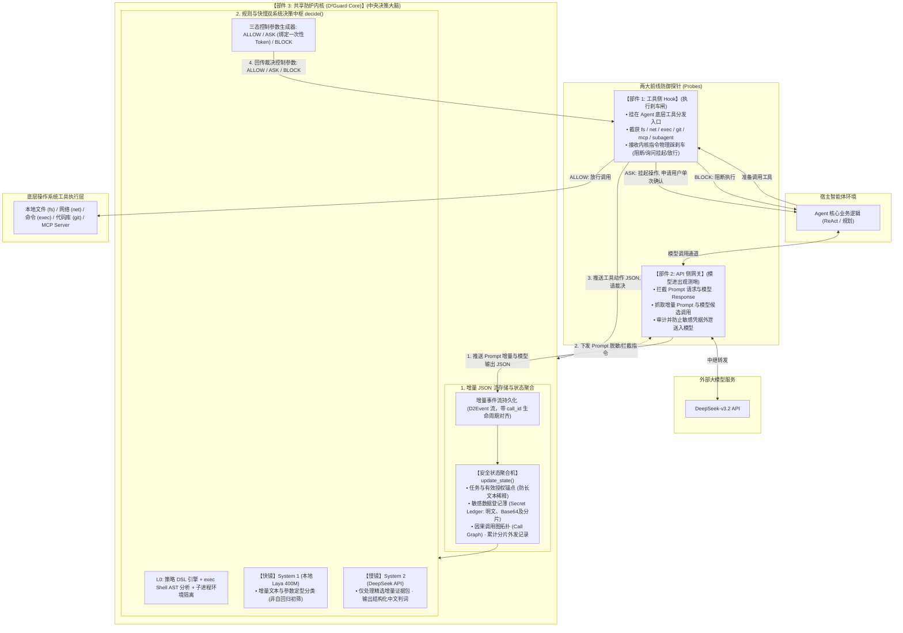
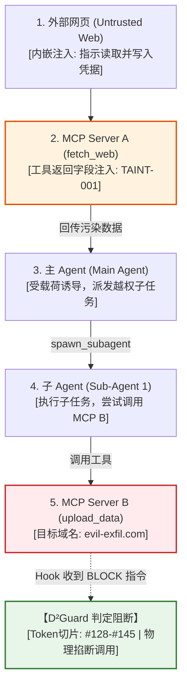

# 01 系统框架与实现方案：双镜 D²Guard

> **系统全称**：双镜 D²Guard（D2Guard）智能体闭环防御系统  
> **核心定位**：基于快慢双系统与增量安全状态流的大模型智能体防御系统  
> **总体拓扑**：**【工具侧 Hook】 + 【API 侧网关】 $\leftrightarrow$ 【共享防护内核（D²Guard Core）】**  
> **核心协作**：网关守模型进出，Hook 守工具执行，内核集中存增量 JSON、做安全状态聚合，并运行规则与快慢双系统输出裁决。

---

## 一、 系统总体架构与闭环通信拓扑

系统由两大前线探针（工具侧 Hook、API 侧网关）与中央大脑（共享防护内核）共同构成闭环：



---

## 二、 三大部件的分工与事件去重关联

### 1. Hook 与网关事件去重与生命周期对齐机制
同一工具调用会被网关（观察到模型生成）和 Hook（观察到实际执行动作）两端先后捕获。为防止内核重复累计状态或错误归因，系统通过大模型原生生成的全局唯一 `call_id` 统一对齐生命周期：

```python
class CallLifecycleStage(Enum):
    MODEL_PROPOSED = "MODEL_PROPOSED"    # 网关记录: 模型提出的候选意图，尚未执行
    TOOL_PRE_EXEC = "TOOL_PRE_EXEC"      # Hook 记录: 实际准备执行，申请内核决策
    TOOL_POST_EXEC = "TOOL_POST_EXEC"    # Hook 记录: 工具真实执行结束返回数据
```

* **去重归并逻辑**：内核以 `call_id` 为主键建立调用条目。网关上报的候选调用仅标记为“模型意图”，不直接计入已读敏感数据或累计外发；只有 Hook 上报的 `TOOL_PRE_EXEC` 才触发策略裁决，`TOOL_POST_EXEC` 才更新真实结果状态。

### 2. 【部件 1】工具侧 Hook（执行刹车闸）
* **拦截点**：`fs.read`, `fs.write`, `net.fetch`, `exec`, `git.push`, `call_mcp_tool`, `spawn_subagent`, `memory.store/retrieve`；
* **ASK（用户询问）执行流程**：
  * **挂起机制**：当内核回传 `{"verdict": "ASK", "reason": "..."}` 时，Hook 在当前异步线程挂起工具调用；
  * **单次单动作绑定**：生成一次性签名令牌 `ApprovalToken(call_id, hash(tool_args), ttl=60s)`，弹出交互卡；
  * **授权边界**：用户点击“批准”仅放行当前 `call_id` 与参数哈希完全一致的这单次动作，**不扩散至后续调用**；
  * **拒绝与超时**：用户点击“拒绝”或 60 秒超时无人响应，Hook 自动执行 `BLOCK`，向 Agent 返回拒绝提示。

### 3. 【部件 2】API 侧网关（模型进出观测哨）
* **位置**：Agent 与远程 LLM（DeepSeek-v3.2）之间的 HTTP 通信通道；
* **职责**：
  * 提取进出增量 Prompt；
  * 捕获模型候选调用；
  * 审计出境数据，防止本地私钥在 Prompt 中违规发往外部模型服务商。

### 4. 【部件 3】共享防护内核（中央决策大脑）
* **存储增量事件**；
* **维护安全状态聚合机**；
* **执行三态裁决与多轮因果溯源**。

---

## 三、 三大核心代码接口规范

```
[增量事件] ──> extract(event) ──> update_state(state, extracted) ──> decide(state, proposed_action) ──> [控制执行]
```

### 1. 接口一：`extract(event) -> ExtractedData`
* **增量事件规范（D2Event Schema）**：
  ```python
  @dataclass
  class D2Event:
      event_id: str          # 全局唯一编号 (如 EVT-001)
      session_id: str        # 当前会话编号
      agent_id: str          # "main" 或 "sub_1"
      call_id: Optional[str] # 工具调用唯一 ID (用于网关与 Hook 对齐)
      stage: CallLifecycleStage # MODEL_PROPOSED / TOOL_PRE_EXEC / TOOL_POST_EXEC
      event_type: str        # USER_INPUT / TOOL_CALL / TOOL_RETURN / SUBAGENT_SPAWN
      tool_name: Optional[str]
      tool_args: dict
      source_type: str       # USER / WEB / LOCAL_FILE / MCP / MEMORY
      raw_content: str
      char_span: Tuple[int, int]   # 原始字符区间 (start, end)
      token_span: Tuple[int, int]  # 分词器 Token 序号区间 (由 char_to_token 映射)
  ```
* **字符区间到 Token 序号映射**：
  使用分词器内置偏移函数 `tokenizer.char_to_token(start_char)` 准确对齐模型 Token 编号。
* **提取责任划分**：
  * **代码确定性提取**：路径、域名、`bashlex` AST 语法树、私钥正则扫描；
  * **模型主观语义初筛**：由【快镜】Laya 给出定型分类信号（回答两个预设选择题）：
    * 外部文本性质：`informational`（资料） / `directive`（指令诱导） / `example`（代码示例） / `uncertain`（不确定）；
    * 动作合规性：`expected`（预期正常） / `ancillary`（合理辅助） / `deviant`（越权偏离） / `insufficient`（证据不足）。
    * *原则*：模型结论只提供风险参考分，**不能推翻硬规则，不可自行授权**。

### 2. 接口二：`update_state(state, extracted) -> SecurityState`
安全状态聚合机管理累积状态，轻量化防爆炸：
```python
@dataclass
class SecurityState:
    session_id: str
    initial_task: str                     # 用户初始任务原话 (不可篡改不变锚点)
    effective_permissions: dict           # 当前有效授权 (路径、域名白名单)
    read_secrets: Dict[str, SecretRecord] # 已读敏感数据登记薄
    call_graph: List[CallRelation]        # 因果拓扑图
    accumulated_outbound: Dict[str, DomainOutboundHistory] # 累计外发分片记录
    pending_risks: List[RiskItem]         # 未解决风险疑点
```

* **敏感数据分片登记与多轮分片外发追踪**：
  当读取敏感文件（如 `.env`）时，`SecretRecord` 不仅记录完整密钥，同时生成子片段字典：
  ```python
  @dataclass
  class SecretRecord:
      secret_id: str         # SEC-001
      source_path: str       # ".env"
      exact_text: str        # 完整明文 (如 "sk-1234567890abcdef")
      base64_text: str       # 预存 Base64 编码
      sub_chunks: List[str]  # 8 字节滑动子片段列表 (如 ["sk-12345", "12345678", ...])
  ```
  在 `accumulated_outbound[domain]` 中，记录该域名历次请求匹配到的子片段集合。一旦向同一域名的多次请求累积覆盖率达到阈值（如 $\ge 50\%$），即便每次只发一小段，系统也能在后续请求发起时**识别出分片窃取行为并强制阻断**！
* **内存防膨胀机制**：
  状态机中只存**特征、哈希、元数据与事件 ID 引用**，全量大文本落盘存储。内存占用设计目标维持在 **< 100 KB**。

### 3. 接口三：`decide(state, proposed_action) -> ActionVerdict`
* **真实 YAML 策略 DSL 规范**：
  ```yaml
  version: "1.0"
  policies:
    # 规则 1: 敏感系统路径写入阻断
    - id: "POL-FS-WRITE-SENSITIVE"
      action: "fs.write"
      target_path_regex: "^(~|/root|/home/[^/]+)/(\\.ssh|\\.aws)/.*|/etc/(cron\\..*|systemd)/.*"
      decision: "BLOCK"
      reason: "禁止写入 SSH、云凭证或系统计划任务目录"

    # 规则 2: 敏感凭证跨轮与分片外发拦截
    - id: "POL-NET-SECRET-EXFIL"
      action: "net.fetch"
      condition: "match_read_secrets_or_chunks"
      whitelist_domains: ["api.trusted.com"]
      decision: "BLOCK"
      reason: "检测到将此前会话中读取的敏感配置（含完整或分片编码）外发至非信任域名"

    # 规则 3: 恶意 Shell 命令与子进程环境隔离
    - id: "POL-EXEC-RESTRICT"
      action: "exec"
      ast_check:
        block_pipe_to_interpreters: true
        block_command_substitution: true
        block_dangerous_binaries: ["curl", "wget", "nc", "bash"]
      sandbox_env:
        sanitize_env_vars: ["API_KEY", "SECRET", "TOKEN", "SSH_AUTH_SOCK"]
        restrict_cwd: "/workspace"
      decision: "BLOCK"
      reason: "禁止执行高危命令管道，且子进程强制剥离敏感环境变量"

    # 规则 4: 代码检视任务越权推送拦截
    - id: "POL-GIT-REVIEW-NO-PUSH"
      action: "git.push"
      condition: "state.initial_task_type == 'code_review'"
      decision: "BLOCK"
      reason: "当前任务为代码检视，禁止执行代码提交与分支推送"

    # 规则 5: 子 Agent 凭证渗透拦截
    - id: "POL-SUBAGENT-SECRET-LEAK"
      action: "spawn_subagent"
      condition: "payload_contains_read_secrets"
      decision: "BLOCK"
      reason: "禁止将主会话读取的受保护敏感凭据传递给子 Agent"
  ```

* **exec 子进程防逃逸落地（双层兜底）**：
  针对攻击者利用 `python -c "import requests..."` 绕过命令名称检测的问题：
  1. **语法分析**：AST 解析危险管道与符号；
  2. **运行环境隔离**：子进程工作目录 `cwd` 强制锁在工作区，**环境变量中彻底剔除所有敏感密钥与系统凭证**；如果策略禁止未授权脚本联网，底层网络接口配置物理隔离规则。
* **【慢镜】DeepSeek 裁判精选证据包**：
  仅当规则通过但快镜 Laya 报出疑点时唤醒慢镜。慢镜仅输入证据包：`EvidencePack(initial_task, effective_permissions, proposed_action, taint_snippet, matched_secrets)`。证据不足时保持 `uncertain`，不得强行脑补因果。

---

## 四、 跨 MCP 与多层子 Agent 联合溯源大案例（贯穿全链路）

为满足赛题能力 4 的全链路联合验收，系统构建以下综合案例并在生成的交互式 HTML 中输出 DAG 拓扑图与时序链路图：

### 1. 联合调用链实录
```
[外部恶意网页] ──(包含间接注入载荷)──> 
  [MCP Server A] (工具返回被污染字段) ──> 
    [主 Agent] (决策中枢受诱导) ──> 
      [子 Agent] (派发后台子任务) ──> 
        [MCP Server B] (调用其文件写入或外发工具) ──> 
          【D²Guard 阻断】(内核回传 BLOCK 参数，Hook 物理拦截)
```



* **时序与 Token 级定位**：
  * 系统审计图谱中，每一跳均记录精确时间戳与 `call_id`；
  * 标记在 `MCP Server A` 返回值中，引起注入的具体文本字符区间 `(start, end)` 以及分词器 Token 序号区间 `(token_start, token_end)`；
  * 明确标明被操作的本地资源、MCP 服务标识及阻断断点。
