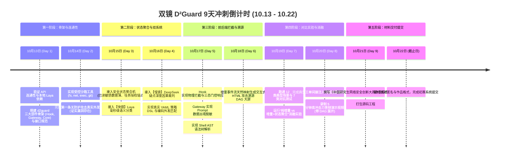

# 03 开发交接与启动说明：双镜 D²Guard 9天实战冲刺指南

> **截止日期**：2026 年 10 月 22 日（初赛作品提交截止）  
> **当前状态**：技术方案已彻底完善并写实为 **双镜 D²Guard**：【工具侧 Hook】 + 【API 侧网关】 $\leftrightarrow$ 【共享防护内核】，通过 `extract`、`update_state`、`decide` 三大接口全面贯通。

> **协作与发布（2026-10-14 更新）**：每位成员独立 clone [团队私有仓库](https://github.com/ZXFqwert/D2Guard)，开发验证后提交并合并到 `main`，由部署人在算力机执行 `./deploy.sh update`，再到 [公网平台](https://agent.li33.art/safe) 验收。完整操作及核查边界见 [README 第七节](README.md#七-团队多端协同开发工作流反重力--codex--算力机)。后面的 10 月 13 日冲刺安排保留为历史计划，不代表源码尚未创建。

---

## 一、 当前工程资产与配置清单

截至 2026 年 10 月 13 日，根目录资产清单：

| 资产项 | 位置与说明 | 当前状态 |
| :--- | :--- | :--- |
| **赛题原件与模板** | 根目录下 DOCX 赛题及三份官方参赛声明模板 | 保留，作为文档编写基准 |
| **模型 API 凭据** | `E:\大论文\93大论文\创新大赛\.env` | 已配置 `LLM_BASE_URL`、`LLM_API_KEY`、`LLM_MODEL` (deepseek-v3.2) |
| **理论与设计文档** | `README.md`、`00_...`、`01_...`、`02_...` | **已全面更新为 双镜 D²Guard 真实工程体系** |
| **核心源码目录** | `E:\大论文\93大论文\创新大赛\d2guard\` | 已存在并纳入 GitHub；在各自独立 clone 中继续开发 |

---

## 二、 9 天实战冲刺路线图（10月13日 - 10月22日）

将所有开发精力聚焦在三大核心部件与三大接口上：

以下为 2026 年 10 月 13 日拟定的历史路线图；实际完成情况以仓库代码、验证记录和当前任务为准。



---

## 三、 本地快速启动与环境准备

系统完全使用标准 Python 模块化构建，支持在本地 Python 3.10+ 环境下开箱即用：

### 1. 创建虚拟环境
```bash
conda create -n d2guard python=3.10 -y
conda activate d2guard
```

### 2. 安装核心依赖
```bash
python -m pip install -r requirements.txt
# 如需启用 Laya 模型，再按模型环境要求安装相应依赖。
```

### 3. 第一阶段开发步骤（10 月 13 日历史计划）
1. 编写环境验证脚本 `tests/test_env.py`，验证 `.env` 中 `deepseek-v3.2` API 连通性与本地 `laya` 推断；
2. 搭建 `d2guard/` 目录中三大部件（`hook.py`, `gateway.py`, `core.py`）骨架；
3. 跑通第一个攻击用例：证明无防护时 Agent 确实会执行高危外发。

---

## 四、 核心代码目录结构

保持代码库结构高内聚、易阅读、易提交：

```
创新大赛/
├── .env                          # 模型 API 密钥配置 (已存在)
├── README.md                     # 项目介绍与快速开始 (已更新)
├── 00_比赛要求与最终交付.md       # 赛题指标对齐 (已更新)
├── 01_系统框架与实现方案.md       # 三大部件协同与三大接口详述 (已更新)
├── 02_实验场景与验收方案.md       # 状态消融实验与客观验收标准 (已更新)
├── 03_开发交接与启动说明.md       # 9 天冲刺计划与启动说明 (已更新)
├── d2guard/                      # 【D²Guard 防护中枢源码】
│   ├── __init__.py
│   ├── hook.py                   # 部件 1: 工具侧 Hook (执行刹车闸)
│   ├── gateway.py                # 部件 2: API 侧网关 (模型进出观测哨)
│   ├── core.py                   # 部件 3: 共享防护内核中枢 (中央决策大脑)
│   ├── extract.py                # 接口 1: 确定性事实与快镜语义抽取
│   ├── state_aggregator.py       # 接口 2: 安全状态聚合机与敏感数据薄
│   ├── decide.py                 # 接口 3: 策略 DSL 匹配与慢镜深度裁判
│   ├── fast_mirror.py            # 【快镜】System 1 (本地 Laya 400M)
│   ├── slow_mirror.py            # 【慢镜】System 2 (DeepSeek 裁判)
│   ├── provenance_dag.py         # 因果事件流直接导出 HTML DAG 图
│   └── normalizer.py             # 7 类对抗样本规范化清洗器
├── agent/                        # 被保护的真实 Agent 环境
│   ├── react_agent.py            # ReAct Agent 核心实现
│   └── tools/                    # 受控工具集 (fs, net, exec, git, mcp)
├── policies/                     # 安全策略配置目录 (YAML)
│   └── default_policy.yaml
├── benchmarks/                   # 12 类典型场景与 7 类对抗测试集
└── run_eval.py                   # 自动化攻防对比与消融评测套件
```

---

## 五、 多端协同开发工作流（反重力 + Codex + 算力机）

| 开发端 | 定位 | 职责 | 同步方式 |
| :--- | :--- | :--- | :--- |
| **各成员独立 clone** | 反重力 / Codex / 手工开发 | 编写防御规则、Agent 逻辑、前端及文档，完成本地验证 | push 自己的开发分支，再合并到 `main`；直接提交 `main` 时先协调同步 |
| **GitHub** | 单一枢纽 | 源码中心 (`https://github.com/ZXFqwert/D2Guard`) | Git 协同 |
| **算力机部署目录 (10.33.0.30)** | 对外服务 | 运行 Web 演练大屏，由当次部署人统一发布 | 在已核实的部署目录执行 `./deploy.sh update`，拉取 `main`、安装依赖并重启，可能短暂中断 |
| **算力机独立开发目录** | GPU 训练 / 评测 / Codex 开发 | 使用 GPU 做实验，不共用生产代码目录和虚拟环境 | 源码进入 GitHub `main` 后，再由部署目录更新 |
| **公网大屏** | 展示汇报门户 | `https://agent.li33.art/safe` (VPS 反代算力机服务) | 实时在线访问 |

* **同步范围**：Git 同步已提交的源码、文档、策略和依赖清单；本机未提交改动不自动出现在公网。各环境从 `.env.example` 分别配置 `.env`，密钥、虚拟环境、运行日志不随 Git 同步；依赖未锁版本，不承诺环境完全相同。
* **触发方式**：push / 合并到 `main` 后，仍需部署人在算力机人工触发一键更新；当前 GitHub Actions 工作流和仓库 Webhook 数量均为 0，未核实外部自动部署入口。算力机登录入口、部署目录绝对路径及实际进程管理方式由部署人核实。
* **验收**：记录部署提交，查看实际进程和日志，再检查公网页面及 `/safe/api/models`；脚本成功提示不能替代验收。`deploy.sh status/logs` 当前也会初始化环境、安装依赖，不是只读命令。
* **并行开发边界**：当反重力或其他成员正在同一目录开发时，不切分支、pull、reset、clean、覆盖源码或重启其服务。只读审查可进行；文档修改需检查已有改动，保留他人的内容。

---

## 六、 新会话启动提示词（可直接复制发给新反重力/Codex 会话）

> 我正在参加“华为杯”第五届中国研究生网络安全创新大赛（揭榜赛题 5：面向大模型智能体提示注入与工具滥用的检测防御技术，安天出题）。
>
> 我们已经确立并落地了核心系统架构：**双镜 D²Guard（基于快慢双系统与增量安全状态流的大模型智能体防御系统）**：
> 1. **代码仓库**：GitHub 私有仓库 `https://github.com/ZXFqwert/D2Guard`，默认发布分支为 `main`。各成员在独立 clone 中开发；算力机现有部署目录与运行方式先核实，不假设已完全同步。
> 2. **演示大屏**：FastAPI 后端已通过专用通道挂载至公网 `https://agent.li33.art/safe`，包含 8 大核心攻防场景及 DAG 因果拓扑展示。
> 3. **核心三大接口**：`extract(event)` $\to$ `update_state(state, extracted)` $\to$ `decide(state, proposed_action)` 已全面贯通。
>
> 在各自环境安全配置 `.env`，不要显示或提交密钥。先确认当前目录是否有其他成员/反重力正在开发、是否有未提交改动；保留其工作，不擅自切分支、pull、覆盖代码或重启服务。源码通过 GitHub 协作，合并到 `main` 后由部署人在算力机执行 `./deploy.sh update`，再到公网验收；push 本身不代表上线。请结合当前已完成内容推进下一阶段任务：
> 1. 完善真实策略 DSL 与滑动窗口分片检测逻辑；
> 2. 扩充 12 类典型场景与 7 类对抗样本测试集；
> 3. 运行“纯增量 vs 增量+安全状态聚合”的客观消融实验，收集量化防御与召回数据。

