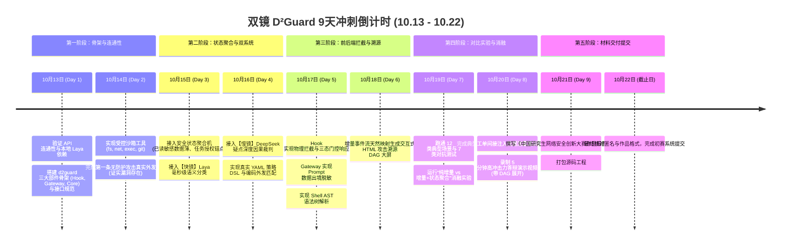

# 03 开发交接与启动说明：双镜 D²Guard 9天实战冲刺指南

> **截止日期**：2026 年 10 月 22 日（初赛作品提交截止）  
> **当前状态**：技术方案已彻底完善并写实为 **双镜 D²Guard**：【工具侧 Hook】 + 【API 侧网关】 $\leftrightarrow$ 【共享防护内核】，通过 `extract`、`update_state`、`decide` 三大接口全面贯通。

---

## 一、 当前工程资产与配置清单

截至 2026 年 10 月 13 日，根目录资产清单：

| 资产项 | 位置与说明 | 当前状态 |
| :--- | :--- | :--- |
| **赛题原件与模板** | 根目录下 DOCX 赛题及三份官方参赛声明模板 | 保留，作为文档编写基准 |
| **模型 API 凭据** | `E:\大论文\93大论文\创新大赛\.env` | 已配置 `LLM_BASE_URL`、`LLM_API_KEY`、`LLM_MODEL` (deepseek-v3.2) |
| **理论与设计文档** | `README.md`、`00_...`、`01_...`、`02_...` | **已全面更新为 双镜 D²Guard 真实工程体系** |
| **核心源码目录** | `E:\大论文\93大论文\创新大赛\d2guard\` | **即刻开始创建与编码** |

---

## 二、 9 天实战冲刺路线图（10月13日 - 10月22日）

将所有开发精力聚焦在三大核心部件与三大接口上：



---

## 三、 本地快速启动与环境准备

系统完全使用标准 Python 模块化构建，支持在本地 Python 3.10+ 环境下开箱即用：

### 1. 创建虚拟环境
```bash
conda create -n d2guard python=3.10 -y
conda activate d2guard
```

### 2. 安装核心依赖
```bash
pip install openai pydantic jinja2 python-dotenv bashlex pyyaml
# 安装【快镜】本地决策小模型依赖 (支持 CPU / 普通 GPU，显存 < 1GB)
pip install laya
```

### 3. 第一阶段开发步骤（今日任务）
1. 编写环境验证脚本 `tests/test_env.py`，验证 `.env` 中 `deepseek-v3.2` API 连通性与本地 `laya` 推断；
2. 搭建 `d2guard/` 目录中三大部件（`hook.py`, `gateway.py`, `core.py`）骨架；
3. 跑通第一个攻击用例：证明无防护时 Agent 确实会执行高危外发。

---

## 四、 核心代码目录结构规划

保持代码库结构高内聚、易阅读、易提交：

```
创新大赛/
├── .env                          # 模型 API 密钥配置 (已存在)
├── README.md                     # 项目介绍与快速开始 (已更新)
├── 00_比赛要求与最终交付.md       # 赛题指标对齐 (已更新)
├── 01_系统框架与实现方案.md       # 三大部件协同与三大接口详述 (已更新)
├── 02_实验场景与验收方案.md       # 状态消融实验与客观验收标准 (已更新)
├── 03_开发交接与启动说明.md       # 9 天冲刺计划与启动说明 (已更新)
├── d2guard/                      # 【D²Guard 防护中枢源码】
│   ├── __init__.py
│   ├── hook.py                   # 部件 1: 工具侧 Hook (执行刹车闸)
│   ├── gateway.py                # 部件 2: API 侧网关 (模型进出观测哨)
│   ├── core.py                   # 部件 3: 共享防护内核中枢 (中央决策大脑)
│   ├── extract.py                # 接口 1: 确定性事实与快镜语义抽取
│   ├── state_aggregator.py       # 接口 2: 安全状态聚合机与敏感数据薄
│   ├── decide.py                 # 接口 3: 策略 DSL 匹配与慢镜深度裁判
│   ├── fast_mirror.py            # 【快镜】System 1 (本地 Laya 400M)
│   ├── slow_mirror.py            # 【慢镜】System 2 (DeepSeek 裁判)
│   ├── provenance_dag.py         # 因果事件流直接导出 HTML DAG 图
│   └── normalizer.py             # 7 类对抗样本规范化清洗器
├── agent/                        # 被保护的真实 Agent 环境
│   ├── react_agent.py            # ReAct Agent 核心实现
│   └── tools/                    # 受控工具集 (fs, net, exec, git, mcp)
├── policies/                     # 安全策略配置目录 (YAML)
│   └── default_policy.yaml
├── benchmarks/                   # 12 类典型场景与 7 类对抗测试集
└── run_eval.py                   # 自动化攻防对比与消融评测套件
```

---

## 五、 多端协同开发工作流（反重力 + Codex + 算力机）

| 开发端 | 定位 | 职责 | 同步方式 |
| :--- | :--- | :--- | :--- |
| **本地 (反重力)** | 开发主力机 | 编写防御规则、优化 ReAct Agent 逻辑、前端大屏优化、本地快速单测 | `git push origin main` |
| **GitHub** | 单一枢纽 | 源码中心 (`https://github.com/ZXFqwert/D2Guard`) | Git 协同 |
| **算力机 (10.33.0.30)** | 生产与 GPU 算力机 | 运行 24/7 Web 演练大屏、使用 2×A100 GPU 跑大批量对抗评测与模型微调 | `./deploy.sh update` (拉取并热重载) |
| **公网大屏** | 展示汇报门户 | `https://agent.li33.art/safe` (VPS 反代算力机服务) | 实时在线访问 |

* **对称性保证**：本地环境与算力机环境在**代码、依赖库、LLM API 凭证**上 100% 对齐；前端页面在本地打开时自动连接本地服务，在公网打开时自动连接公网接口，无需手动改动任何代码。

---

## 六、 新会话启动提示词（可直接复制发给新反重力/Codex 会话）

> 我正在参加“华为杯”第五届中国研究生网络安全创新大赛（揭榜赛题 5：面向大模型智能体提示注入与工具滥用的检测防御技术，安天出题）。
>
> 我们已经确立并落地了核心系统架构：**双镜 D²Guard（基于快慢双系统与增量安全状态流的大模型智能体防御系统）**：
> 1. **代码仓库**：GitHub 私有仓库 `https://github.com/ZXFqwert/D2Guard` 已建好，本地与算力机（2×A100, `10.33.0.30`）均已拉取就绪。
> 2. **演示大屏**：FastAPI 后端已通过专用通道挂载至公网 `https://agent.li33.art/safe`，包含 8 大核心攻防场景及 DAG 因果拓扑展示。
> 3. **核心三大接口**：`extract(event)` $\to$ `update_state(state, extracted)` $\to$ `decide(state, proposed_action)` 已全面贯通。
>
> 根目录 `.env` 已配置模型密钥。请帮我推进下一阶段任务：
> 1. 完善真实策略 DSL 与滑动窗口分片检测逻辑；
> 2. 扩充 12 类典型场景与 7 类对抗样本测试集；
> 3. 运行“纯增量 vs 增量+安全状态聚合”的客观消融实验，收集量化防御与召回数据。

