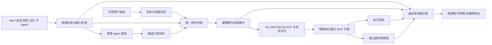

# D²Guard 第二版复核与冲奖升级路线

研究日期：2026 年 10 月 14 日。审查版本：`8c5c3b738c978731bc08b8b9dcbb14ed2eca14e4`。

建议保留双镜、Hook、Gateway 和增量状态机的工程骨架，把第三版的重点放到 **真实 MCP 与子 Agent 链上的执行许可、秘密外发约束和可复核执行证据**。当前最需要补的是比赛强制能力与证据可信度；单靠增加场景、升级裁判模型或优化界面，还不足以形成一等奖竞争力。

第二版已具备真实 ReAct 循环和执行前 Hook，但多项评测指标及预设演示仍由常量或脚本产生，真实 MCP、子 Agent、跨会话记忆和 ASK 交互尚未闭环。因此，“可以稳过初赛”目前不能由现有评测材料证实。应先修正这一判断所依赖的证据，再用完整实验确定竞争力。

本次只读审查源码、官方赛题原件与公开项目源码，核查 GitHub `main` 和公网 HTML；公网 HTML 与本地第二版前端一致。没有运行模型、攻击、评测、部署或修改业务代码。以下代码发现为静态证据，不能替代运行复测。内置浏览器连接公网时返回 `ERR_CONNECTION_CLOSED`，未取得有效截图，因此本文不作视觉布局或完整交互体验的实测判断。

配套材料：[前沿项目源码研究](05_前沿项目源码研究与借鉴.md)、[可信评测与答辩展示设计](06_可信评测与答辩展示设计.md)。

## 1 赛题真正要求什么

本地官方原件为 [赛题 5 DOCX](05-26年网安揭榜赛赛题-面向大模型智能体提示注入与工具滥用的检测防御技术.docx)，其正文第 14—46 段要求在线运行 Agent 的检测、研判、阻断、溯源闭环，并明确以下能力：

| 官方能力 | 当前版本有的基础 | 还需要实际证明的部分 |
| --- | --- | --- |
| 多源注入识别 | 规则快筛、工具事件、模型通信拦截 | 真正读取恶意网页、MCP 描述/返回、记忆召回；识别结果进入后续控制，而不是只记录风险 |
| 意图 计划 工具语义对齐 | 初始任务字段、慢镜证据包 | 真实计划与动作的偏离，参数来源与授权来源；裁判不能把受污染材料当成用户授权 |
| 语义策略 DSL 与三态决策 | 五类固定动作检查、ASK 令牌原型 | 可解释执行的策略语言；批准、拒绝、过期、恢复、单次消费的真实 ASK 闭环 |
| 跨 MCP 与子 Agent 溯源 | PRE/POST 事件、call_id、事件图 | 多服务、多层 Agent 的真实关系；攻击文本原文与 token 归属；裁决、参数、返回与资源副作用的完整记录 |
| 七类抗绕过能力 | 规范化、秘密匹配、部分命令分析 | 对实际进入 Agent 的载荷做多语言、Unicode、编码、分片、多轮和上下文稀释评测，保留正常任务能力 |

赛题第 23 段明确要求超越仅按工具名和路径黑白名单匹配的方式。第 53 段按功能完成度、技术先进性、工程化质量、攻防对抗验证综合评分，真实已知漏洞防御与企业落地有额外加分。四份赛题交付件是部署、设计、源码、测试样例与流程；项目自行设置的 `<20ms`、`<100KB` 等目标不是这份任务书给出的硬指标。

[官方邀请函](https://cpipc.acge.org.cn/cw/contestNews/detail/2c90800c8093eef401809d33b36f0652/2c9080199ed8b78d019ed96ceea21560?page=1)规定初赛作品截止为 2026 年 10 月 22 日，决赛采用 20 分钟陈述、演示、测试和问答，并会现场检查源码。当前应按“初赛前形成可信最小闭环，决赛前完善先进机制”安排工作，保留对后续官方通知的核对。

## 2 第二版值得保留的工程基础

真实 `ReActAgent.run` 已实现模型、工具调用、工具返回与下一轮交互；Hook 的 BLOCK 分支在调用工具函数之前返回。这是有效的防护入口，应保留并扩展，而不是重写整套工程。源码见 [ReAct 循环](agent/react_agent.py)、[执行前 Hook](d2guard/hook.py)。

状态机已有用户任务锚点、已读秘密登记、调用标识和累积外发信息；消融开关已存在。模块拆分清楚，适合逐步替换为可验证的策略和来源机制。前端源码把对比执行、状态、秘密台账和图集中展示，作为证据控制台的方向有价值；之后每个展示数字和节点都应引用真实运行记录。

## 3 最先处理的证据与工程问题

以下行号均对应本次审查 commit；后续修改后应通过该 commit 的 GitHub 文件定位历史证据。

| 优先级 | 发现 | 源码证据 | 对比赛的影响与处置 |
| --- | --- | --- | --- |
| P0 | 分片阻断率和 DAG 完整度直接打印固定 100% | `run_eval.py:353–357, 395–399` | 无法用这些数字证明效果；输出逐例测量结果，旧数字标为待复核或撤回 |
| P0 | Web 指标、双镜风险、11.4ms 耗时和判词由场景常量生成 | `web_demo.py:636–650, 809–822` | 展示不代表本次推理；接入真实 verdict、检测器后端、计时和已发布评测报告 |
| P0 | 预设场景走脚本，输入框仍发送预设 scenario_id；只有 API 的 custom 路径运行真实模型 | `web_demo.py:598–609`; `web_static/index.html:1765–1782` | 自定义输入不能证明泛化防御；明确案例回放与真实运行，接通真正自由测试 |
| P0 | 报表未把 content/payload 注入受害 Agent，只重放既定工具入参 | `run_eval.py:123–125, 196–233` | 现有结果属于动作门控测试，不是提示注入端到端 ASR；重建真实攻击链 |
| P0 | 接收端是同进程列表，发包前就记录，部分域名直接返回测试桩 | `agent/tools/net_tool.py:16–24` | 尝试发送不等于实际接收；使用独立受控 sink，核验实际字节 |
| P0 | 自由 API 可达模型及宿主文件/Shell，源码未见应用鉴权和执行沙箱 | `web_demo.py:559, 703, 850`; `fs_tool.py:20–40`; `exec_tool.py:33–42` | 先隔离公开演练与宿主资源，控制真实运行权限、会话与出站。外层反代是否另有保护尚未核实 |
| P0 | 网络可信判断用子串，域名从所有参数抽出的无序集合选择；重定向未重新审查 | `decide.py:170–181`; `extract.py:165–175`; `net_tool.py:27–30` | 目的地约束可失真；从实际 URL 标准解析，按精确 origin 和重定向逐跳校验 |
| P0 | 编码秘密触发 SANITIZE，但网关只替换完整明文；慢镜也接收未经脱敏参数 | `gateway.py:80–90`; `decide.py:269–276`; `slow_mirror.py:88–124` | 防护模型本身可能成为外发路径；统一所有模型与工具的出站守卫 |
| P0 | 源码含模型服务凭据默认值 | `d2guard/llm_config.py:21` | 后续整改时移出源码并核实凭据处置；研究材料不复述其值 |
| P1 | 工具返回检测风险只记入 pending_risks；决策没有使用它，来源角色被合并 | `state_aggregator.py:187–197`; `core.py:107–126`; `gateway.py:58–76` | “看见注入”未变成“约束后续动作”；建立来源 envelope 与实际控制链 |
| P1 | MCP、Git、子 Agent、记忆仍有桩或未接入 | `subagent_tool.py:8–10`; `react_agent.py:126–128, 161–169`; `run_eval.py:70–75` | 不能支撑强制场景；做真实协议、子任务执行、跨会话召回及测试 Git 远端 |
| P1 | ASK 无批准/拒绝/恢复接口；令牌未完整绑定主体和工具，也未单次消费 | `hook.py:81–110`; `models.py:29–45` | 当前默认拒绝是有价值的安全行为，但不等于 ASK 全流程已完成 |
| P1 | 快镜对 Laya 适配器的 action 和返回字段与已读上游契约不一致；异常或无信号仍走规则 | `fast_mirror.py:65, 152–162`；上游细节见前沿研究第 10 节 | 固定实际包/权重版本，核验真实返回、显示后端和降级原因；部署版本待核查 |
| P1 | YAML 多数字段不解释，策略按固定 ID 分支处理；加载失败可能削弱规则 | `decide.py:50–59, 153–260` | “存在 YAML”不等于语义 DSL；实现类型校验、解释器、拒绝优先和策略版本 |
| P1 | token span 默认为零，计算为正则估算；图主要是 PRE→POST 和时序边 | `models.py:63–64`; `extract.py:119–137, 193–194`; `provenance_dag.py:63–79` | 不能宣称 token 来源和真实因果链完成；分开事实边和推断边，精确回到原文 |
| P1 | 日志缺原始返回、裁决与命中证据，异常还可能记录为 success | `core.py:79–95`; `hook.py:114–141` | 运行结束后难以复盘；增加结构化事件、执行状态和证据 blob |
| P1 | 会话使用共享 GLOBAL_CORE/HOOK/Canary；证据文本直接 innerHTML | `web_demo.py:44–45, 563–576`; `index.html:2591–2599` | 并发证据混淆和界面文本注入；改为会话隔离、来源文本安全渲染 |

源码链接：[评测脚本](run_eval.py)、[Web 后端](web_demo.py)、[策略引擎](d2guard/decide.py)、[网关](d2guard/gateway.py)、[状态机](d2guard/state_aggregator.py)、[抽取器](d2guard/extract.py)、[数据模型](d2guard/models.py)、[网络工具](agent/tools/net_tool.py)、[文件工具](agent/tools/fs_tool.py)、[执行工具](agent/tools/exec_tool.py)、[前端](web_static/index.html)。

这些问题不意味着全部防护无效。它们说明：有效的底层入口与未完成的集成、评测和展示混在一起，当前宣传范围超过了可核验范围。升级的第一步是让实现、测量和叙述重新一致。

## 4 前沿研究如何改变我们的创新定位

双模型、快慢筛选、来源图、任务锚点、污点标签和动作授权，都已经有强相关工作。Google CaMeL、Microsoft FIDES、ARGUS/Warrant、Progent 与 Anthropic 的公开设计分别覆盖了这些方向。2026 年 8 月的 CAITLYN 还提出了反例驱动的防御规则生成与验证。因此不能把这些要素的重新命名写成全球首次提出。

建议采用以下定位，作为待实现、待实验验证的候选贡献：

> 在已有来源审计与最小权限研究基础上，面向真实 MCP 和多层子 Agent 工具链，研究来源保真的动作许可、秘密外发约束及可复核执行证据，使检测、裁决、实际执行与复盘保持一致。

特色不在一个新缩写，而在三个可测问题：**批准的是否就是实际执行的动作；秘密经编码、分片、子 Agent 和裁判模型后是否仍受约束；评委能否独立核实每个防护结论。** 具体已有工作和源码边界见配套前沿研究文档。

## 5 第三版候选架构

下面是设计建议，不表示这些模块已经实现。

### 5.1 来源封装与可信授权

输入统一封装为 `ContentEnvelope`：内容 ID、可信登记的来源/主体、完整原文哈希、消息角色、字符区间、信任和保密标签、检测器版本。来源标签由宿主或受信代理签发，未知 MCP 自报“trusted”不能提高信任级。保留原始与规范化文本的映射，不能只保留清洗后的字符串。

用户授权形成独立 `TaskContract`，表达资源根目录、仓库范围、允许读写能力、允许的目的地/方法、禁止项和授权版本。模型可以提出合同草案，但不能因为工具返回里出现“管理员已批准”就改合同。对待用户输入也要区分来源可信与业务权限：真实用户来源不意味着其拥有任意系统权限。

### 5.2 参数来源与两类裁决证据

候选动作同时提交授权依据和数据来源引用。规则验证主体、工具、规范化入参、资源和数据标签；快镜提供风险信号，慢镜仅审查脱敏后的必要证据。

模型声称某参数来自某片段，不是证明。已知的工具值、引用句柄和编码变换应由宿主记录真实依赖；任意语义改写只能标为推断，不能自动去除污点。无法可靠追踪的变换使用保守约束，或交给隔离、无工具的处理模型，再通过显式授权解除限制。这是控制安全与正常任务误拒绝之间必须实测的取舍。

### 5.3 动作许可与执行回执

对 ALLOW 或人工批准的动作签发许可，绑定：`session_id`、主体/Agent、工具标识、规范化参数哈希、资源版本、任务/策略版本、标签、有效期和单次 nonce。真正执行的代理核验这些字段，原子消费 nonce；重试使用幂等标识查询原回执，不再次产生副作用。

子 Agent 权限必须是父权限的子集，不能通过派发、MCP 中转或改写参数扩大授权。资源或参数变化后旧许可失效，重新裁决。ASK 只批准被询问的具体动作；显式硬禁止项不因普通批准令牌绕过。

这项机制保证的是支持范围内的批准与执行一致性，不是机器证明自然语言意图正确。所有能产生同类副作用的路径都必须被代理或 OS 边界覆盖；只包住 `net.fetch` 而保留无限制 Python/Shell，无法成立。

### 5.4 秘密台账与统一出站

把当前滑动字符串匹配升级为两份记录：受保护数据及已知衍生值的来源记录；实际执行后的外发回执和独立接收记录。按秘密、目标、会话分开统计，区分候选发送、已阻断、实际发送和实际接收，使用实际字节区间计算泄露。

业务模型、慢镜模型、网络工具、子 Agent 提示、公开评论/PR 和模型输出渲染，都进入相同的出站控制。编码命中要定位到真实序列化字段并替换后复检；无法安全替换时拒绝发送。处理未知语义变换、隐蔽通道和不受控外部工具仍有边界，不能承诺任意攻击零泄漏。

### 5.5 可复核证据图

事实边包括请求与返回、参数引用、已知变换、许可消费和资源操作回执；推断边包括模型判断的语义支持或影响，附裁判版本。时间相邻单独画时序边，不能用它证明因果。

每次运行导出事件、证据内容、结构化裁决、模型/策略版本和独立 verifier 结果。敏感原文受控保存，公共答辩只展示随机 Canary、脱敏片段与内容哈希。哈希有助于检测修改，不能单独证明记录完整；完整性还需靠所有执行入口覆盖和回执核对。

### 5.6 双镜与增量缓存

保留快慢架构，但公开本次真实 backend、权重版本、分数和降级原因。快镜候选包括 Prompt Guard 2 与中文领域分类器，先测正常业务、七类绕过及中文分布，再选型；不是直接以模型名称判断先进性。

只缓存无副作用的检测和证据分析，缓存键绑定内容、任务授权、策略、工具 schema 和模型版本。授权或来源改变时传播失效；动作许可不能因相似请求命中缓存重复使用。相比全量重审，受影响子图重审能否降低 p95 和成本，需要在相同安全条件下测量。

## 6 三项候选贡献与验收方法

| 候选贡献 | 相对现有研究的具体研究问题 | 必须做的实验 |
| --- | --- | --- |
| 跨 MCP 与子 Agent 的动作一致性 | 来源审计结果怎样绑定真实执行，而不在转交、并发和重试中失效 | 参数替换、资源变化、授权重放、并发消费、子 Agent 越权；核验真实副作用次数与回执 |
| 秘密外发与裁判出站的统一约束 | 标签与内容匹配怎样共同覆盖工具、模型、委派和公开输出 | 编码/短分片/跨目标/慢镜证据外发；独立 sink 测实际泄露字节，并测合法数据传输成功率 |
| 事实与推断分层的可复核证据 | 裁判结论改变时，来源与执行事实能否仍稳定复核 | 原文区间回跳、不同裁判复核、断线后重建、拒绝事件覆盖；测事实边完整率和证据定位准确率 |

这三项是相对本次所读项目的候选差异，不是已经证明的全球首创。若实现仅为现成库拼接，应如实写为集成贡献；若实验显示稳定收益，再提出方法贡献。第三版应同时说明借鉴来源和本队新增部分。

## 7 初赛前与决赛前的两阶段安排

以下为建议排期，不是已完成任务或获奖保证。

| 时段 | 工作包 | 可验收交付 |
| --- | --- | --- |
| 10 月 14—15 日 | 收紧运行边界与证据口径 | 公开演练隔离方案；会话隔离；所有展示常量标明或移除；真实结果 schema；优先修网络和统一出站缺口 |
| 10 月 16—18 日 | 一个真实 MCP 旗舰闭环及 ASK | 两个隔离资源、真实 MCP 协议、真实受害 Agent、独立 sink/文件/Git verifier；批准拒绝过期和单次消费 |
| 10 月 19—20 日 | 相同初始条件的对照与未见样例 | 分开动作重放与端到端攻击；至少逐项覆盖五项能力，增加正常任务；形成逐例结果和证据包 |
| 10 月 21—22 日 | 复核和提交冻结 | 报告每个数字追溯到固定 commit 结果；设计、部署、测试说明和源码一致；匿名化与离线运行检查 |
| 初赛后至决赛 | 强化差异贡献与现场可靠性 | 多层委派与并发许可；精确来源/变换映射；外部基准与自适应攻击；正常任务/成本/延迟权衡；20 分钟答辩与随机样例演示 |

初赛最小版本也应逐项覆盖强制能力；旗舰案例只是贯穿叙事，不能替代其他场景的真实功能。若某项仍只有桩，应明确状态并优先补齐，不能把未完成工作放进“已具备”表。

当前不建议在初赛前投入大规模模型微调、更多场景皮肤、多模态全覆盖或自动激活模型生成的策略。它们会挤占真实协议接入、授权闭环和可信验证的时间。模型微调与反例驱动规则改进可作为决赛研究，候选规则必须经过固定攻击/良性集合及未见样例验证，不由不可信输入直接扩大权限。

## 8 第三版完成的判据

完成不是所有按钮都能点击，而是以下证据同时成立：真实 Agent 读取实际载荷；真实 MCP/子 Agent/记忆路径被观测；执行前返回真实三态裁决；被拒绝动作没有相关副作用；正常任务能继续；每个数字能由结果文件重算；每个图节点能回到原文、调用或回执。

建议首先实施“证据口径与执行隔离 + 一个真实 MCP 旗舰闭环”，再把动作许可和统一出站机制做成可测的原创升级。
