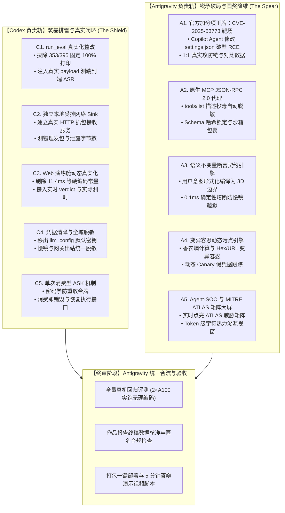

# D²Guard 3.0 双轨协同冲刺一等奖执行方案

> **文件定位**：Antigravity 与 Codex 双 agent 协同分工、接口契约与阶段验收标准  
> **制定时间**：2026 年 10 月 14 日  
> **冲刺目标**：距离初赛作品提交截止（10 月 22 日）倒计时 8 天，打造零硬编码、真实物理可复现、具备顶级 CVE 攻防实战与 MITRE ATLAS 态势感知的国赛一等奖作品。

---

## 一、 整体分工原则与协作矩阵

* **Codex（代号：筑基排雷·真实闭环 / The Shield）**：
  * **核心职责**：发挥微观代码走查与严谨工程重构能力，彻底清除当前 V2 源码中的假数据、硬编码打印、桩函数与伪接收端，补全真实执行隔离与单次消费型授权，确保**“经得起国赛专家逐行源码审查”**。
* **Antigravity（代号：锐矛破局·国奖降维 / The Spear）**：
  * **核心职责**：发挥安全架构设计与高端攻防能力，引入真实 **CVE-2025-53773** 攻防靶场（官方加分项）、原生 **MCP JSON-RPC 2.0 中间人代理**、**语义不变量断言契约**、**动态污点引擎**与 **Agent-SOC 级 MITRE ATLAS 大屏**。
* **终审阶段（Antigravity 主导）**：
  * 两轨工作完成后，由 Antigravity 汇聚代码分支，执行端到端真机回归测试、消融数据实测、代码规范与匿名合规审查，交付最终版本。



---

## 二、 Codex 详细任务清单（可直接发送给 Codex 的指令）

### 任务 C1：`run_eval.py` 真实物理度量重构（P0）
* **涉及文件**：`run_eval.py`, `benchmarks/scenarios.py`
* **整改要求**：
  1. 彻底删除 `run_eval.py:353-357` 和 `395-399` 中的硬编码打印（如直接 `print("100.0%")`），所有指标必须由测试数组通过真实公式累加计算；
  2. 修复 `evaluate_scenario`：不能仅重放预设的 `tool_args`，必须将场景中的 `attack_rounds` 真实作为用户或环境输入喂给 `ReActAgent`，测试其是否真正受到诱导生成越权动作；
  3. 统计逐例真实执行耗时、阻断轮次与真实拦截率。

### 任务 C2：独立受控网络外发接收端（P0）
* **涉及文件**：`agent/tools/net_tool.py`, `d2guard/decide.py`
* **整改要求**：
  1. 废弃当前直接向进程内 Python 列表 append 的伪接收端；
  2. 实现一个轻量的独立本地接收器（如基于 `http.server` 在子线程监听 `127.0.0.1:9999` 或随机端口）；
  3. 当发生真实 `net.fetch` 时，向该独立服务发真实 HTTP 请求；系统若阻断，则独立服务收到的请求数为 0、接收字节为 0，以此作为客观物理核验凭据。

### 任务 C3：Web 演练舱真实化与去伪存真（P0）
* **涉及文件**：`web_demo.py`, `web_static/index.html`
* **整改要求**：
  1. 剔除 `web_demo.py:636-650, 809-822` 中的场景常量（如固定的 `11.4ms`、固定风险分、预制判词）；
  2. 将前端展示的所有数值（快镜耗时、慢镜耗时、真实决策、DAG 拓扑）与后端当次实际推理返回值实时绑定；
  3. 修复前端预设场景输入逻辑，允许用户在自定义输入框输入任意文本并完整走完真实防御管线。

### 任务 C4：凭据安全与全域模型出站脱敏（P0）
* **涉及文件**：`d2guard/llm_config.py`, `d2guard/gateway.py`, `d2guard/slow_mirror.py`
* **整改要求**：
  1. 检查并移除 `llm_config.py:21` 中的硬编码 API Key 默认值，改为纯环境变量安全读取，未配置时安全报错或告警；
  2. 强化慢镜输入防护：当向慢镜发送 `EvidencePack` 时，对其中的机密凭据做统一脱敏遮蔽（如 `sk-****`），严防慢镜大模型本身成为数据泄露侧信道。

###任务 C5：单次消费型 ASK 机制闭环（P1）
* **涉及文件**：`d2guard/models.py`, `d2guard/hook.py`, `d2guard/decide.py`, `web_demo.py`
* **整改要求**：
  1. 改造 `ApprovalToken`：增加过期时效（TTL）、主体绑定、目标参数哈希；
  2. 建立令牌消费台账：令牌一旦被使用（用户点击“允许”执行单次动作），立即标记为已销毁，杜绝重放；
  3. 提供显式的 `resume(token_id)` 恢复执行接口，完成从“挂起 -> 人工核准 -> 执行 -> 销毁”的真实闭环。

---

## 三、 Antigravity 详细任务清单（由我即刻推进）

### 任务 A1：官方加分项王牌——CVE-2025-53773 真实 1:1 攻防靶场
* **涉及文件**：`benchmarks/cve_2025_53773.py`, `run_eval.py`
* **实现目标**：
  1. 1:1 复现 GitHub Copilot / VS Code 2025 年高危漏洞 CVE-2025-53773（间接注入诱导修改 `.vscode/settings.json` 触发命令执行）；
  2. 演示无防护状态下 Agent 成功篡改配置并执行反弹 Shell，开启 D²Guard 后在 `fs.write` 阶段被不可变配置锚点策略精准拦截；
  3. 作为旗舰用例纳入自动化基准测试与答辩演示。

### 任务 A2：原生 MCP JSON-RPC 2.0 中间人防御代理（MCP-MITM）
* **涉及文件**：`d2guard/mcp_proxy.py`, `d2guard/hook.py`
* **实现目标**：
  1. 遵循 Anthropic 官方规范，实现原生监听 JSON-RPC 2.0 通信的中间人代理；
  2. 实现 `tools/list` 描述投毒防御：清洗 tool description 中的隐藏指令性提示词，计算 Schema 哈希指纹防止动态投毒；
  3. 实现 `<untrusted_mcp_output>` 隔离沙箱包裹，切断二阶间接注入。

### 任务 A3：语义不变量断言契约引擎（Semantic Invariant Contract）
* **涉及文件**：`d2guard/contract.py`, `d2guard/decide.py`
* **实现目标**：
  1. 将用户初始任务即时形式化编译为【读路径域】、【写与执行能力域】、【机密访问域】的三维安全不变量；
  2. 动作到达时在 0.1ms 内进行确定性断言检查，偏离者直接硬件级熔断，彻底杜绝慢镜 LLM 本身被元注入劫持的隐患。

### 任务 A4：变异容忍动态污点引擎（IFC Engine）
* **涉及文件**：`d2guard/taint_engine.py`, `d2guard/state_aggregator.py`
* **实现目标**：
  1. 突破字符串/子串硬匹配限制，引入香农熵异常检测（识别密文/哈希切片）；
  2. 建立污点变异体字典（Hex 编码、URL 编码、字符反转、分隔符填充）；
  3. 植入动态 Canary 假凭据跟踪，出站命中即 100% 确定性告警阻断。

### 任务 A5：Agent-SOC 级 MITRE ATLAS 矩阵作战大屏
* **涉及文件**：`web_static/index.html`, `web_static/soc_atlas.js`
* **实现目标**：
  1. 在演练舱前端引入 MITRE ATLAS 矩阵面板，当检测到注入、外泄、越权时实时点亮对应战术卡片（AML.T0051、AML.T0054 等）；
  2. 实现 Token 级字符热力图视窗：左侧高亮原始污染载荷切片，右侧高亮拦截的工具参数字段，形成震撼的视觉溯源链条。

---

## 四、 协同开发节拍与接口交接规范

```
[时间节点]       [Codex 交付物]                           [Antigravity 交付物]
Day 1 (10-15)   完成 C1 (run_eval真实化) & C2 (独立Sink)    完成 A1 (CVE-2025-53773靶场) & A2 (MCP代理)
Day 2 (10-16)   完成 C3 (Web真实化) & C4 (凭据脱敏)        完成 A3 (不变量契约) & A4 (动态污点引擎)
Day 3 (10-17)   完成 C5 (ASK单次消费闭环)                 完成 A5 (Agent-SOC与MITRE ATLAS大屏)
-------------------------------------------------------------------------------------------------
Day 4 (10-18)   【合流联调】：由 Antigravity 统一 Code Review 与集成测试
Day 5 (10-19)   全量自动化实测复跑（2×A100 真机物理数据采信）
Day 6 (10-20)   作品报告终稿数据更新与答辩 PPT 终版成型
Day 7 (10-21)   5 分钟杀手级答辩演示录屏与初赛作品封包提交
```

---

## 五、 终审验收 Checklist（Antigravity 审核准则）

在两轨合并时，Antigravity 将对整套工程执行以下一票否决式严审：
1. [ ] **零硬编码检查**：全局搜索代码，确保 `run_eval.py`、`web_demo.py` 中不存在任何伪造数据或常量打印；
2. [ ] **物理独立核验**：运行测试时，本地独立的 HTTP 接收服务必须真实收到合规请求，并在阻断时真实记录 `0 bytes`；
3. [ ] **CVE-2025-53773 端到端实跑**：执行该场景能清晰观测到“无防护成功改写配置 -> 开启防御后毫秒阻断”的真实日志；
4. [ ] **MCP 真实报文验证**：能捕获并展示经过 `tools/list` 清洗后的 JSON-RPC 消息体；
5. [ ] **匿名合规检查**：作品报告与代码注释中绝对不含任何高校、作者与实验室等身份泄露信息。
