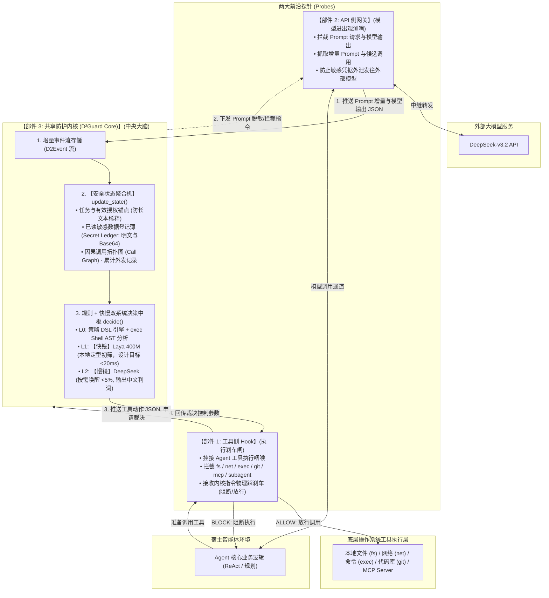

# 双镜 D²Guard: 基于快慢双系统与增量 JSON 状态流的大模型智能体防御系统

> **赛事名称**：“华为杯”第五届中国研究生网络安全创新大赛  
> **参赛赛道**：揭榜挑战赛  
> **赛题方向**：赛题 5 —— 面向大模型智能体与 MCP 工具链的提示注入与工具滥用的检测防御技术（出题单位：安天科技集团）  
> **系统架构**：**【工具侧 Hook】 + 【API 侧网关】 $\leftrightarrow$ 【共享防护内核（D²Guard Core）】**  
> **核心机制**：**$D^1$（Dual-System 快慢双系统） + $D^2$（Delta-JSON 增量状态流与安全状态聚合）**  
> **三大接口**：`extract(event)` $\to$ `update_state(state, extracted)` $\to$ `decide(state, proposed_action)`

> **团队协作入口**：源码在 [GitHub 团队私有仓库](https://github.com/ZXFqwert/D2Guard)，演示在 [公网体验平台](https://agent.li33.art/safe)。每位成员在自己的目录 clone、开发、提交；代码进入 `main` 后，由部署人在算力机运行 `./deploy.sh update` 发布。完整步骤见本文第七节；push 本身不会自动上线。

> **The Shield 验收入口**：本地整改分支的真实评测、HTTP 字节核验、模型脱敏与 ASK 接口见 [docs/SHIELD_ACCEPTANCE.md](docs/SHIELD_ACCEPTANCE.md)。该文档中的实施状态与测量口径优先于本文原 V2 能力介绍；未完成适配的场景不计作防护成功。

---

## 一、 系统总体架构：前线双探针与中央决策大脑

系统由三大紧密协作的部件构成闭环：
1. **【部件 1: 工具侧 Hook】**：守在工具执行侧，物理拦截本地工具、MCP 与子 Agent 执行（执行刹车闸）；
2. **【部件 2: API 侧网关】**：守在大模型通信侧，抓取 Prompt 增量与模型候选调用，审计数据外泄（模型观测哨）；
3. **【部件 3: 共享防护内核】**：中央决策大脑，持久化存储增量 JSON，维护**安全状态聚合机**，运行**策略引擎 + 快慢双系统**，回传裁决控制参数。



---

## 二、 三大核心接口运行逻辑

系统所有防御机制均通过三个极简、清晰的 Python 核心接口实现：

### 1. `extract(event) -> ExtractedData`
* **代码确定性提取**：解析文件绝对路径、目标网络域名、用 `bashlex` 解析 Shell 抽象语法树（管道、重定向、子 Shell）、正则扫描私钥与敏感 Canary 标记；
* **模型主观语义初筛**：由【快镜】Laya（421M 双向编码器，本地部署）给出定型分类信号（判断外部增量是正常资料还是指令诱导，当前动作是预期步骤还是越权行为）。模型结论作为风险参考分，不可推翻硬规则。

### 2. `update_state(state, extracted) -> SecurityState`
* **安全状态聚合机**：解决“单看增量会丢失多轮记忆”的致命问题；
* 记录用户初始任务（不可篡改不变锚点）、更新已读敏感数据登记薄（记录文件路径、数据 ID、明文与预存 Base64 编码）、累积外发域名历史与因果调用链；
* **轻量防爆炸**：内存中只存元数据与事件 ID 引用，100 步长程任务内存占用设计目标保持在 **< 100 KB**。

### 3. `decide(state, proposed_action) -> ActionVerdict`
* **规则评估**：策略 DSL 检查路径黑名单（`~/.ssh`）、检测请求体中是否包含此前读取的敏感数据（原文及 Base64 编码匹配）、拦截危险 Shell 管道命令；
* **慢镜仲裁**：存在疑点时唤醒【慢镜】DeepSeek，只输入精选证据包，输出结构化中文判词；
* **控制参数回传**：向宿主 Hook 回传 `{"verdict": "BLOCK", "reason": "..."}`，Hook 在底层物理掐断工具调用。

---

## 三、 赛题五项核心能力逐项对齐

| 赛题要求 | 双镜 D²Guard 落地实现 |
| :--- | :--- |
| **能力 1：多源注入识别** | 网关与 Hook 截获用户输入、外部 Web/文档/源码/MCP 返回、记忆召回等每一个事件，快镜毫秒级初筛。 |
| **能力 2：意图-计划-动作对齐** | 状态聚合机保留初始任务锚点，慢镜仅比对精选证据包，输出标准结构化中文裁判理由。 |
| **能力 3：细粒度策略与三态决策** | 内核执行 YAML 声明式策略 DSL 与 AST 检查，回传 `ALLOW` / `ASK` / `BLOCK` 参数给 Hook 严格执行。 |
| **能力 4：跨 MCP 与子 Agent 溯源** | 事件流自带 `parent_id` 链条，内核一键直接导出交互式 HTML 攻击溯源 DAG 大屏。 |
| **能力 5：对抗鲁棒性** | 前置清洗器处理多语言、Unicode、注释与编码；安全状态机独立持久化，天然免疫长上下文稀释。 |

---

## 四、 快速上手与工程目录结构

### 1. 运行环境准备
```bash
conda create -n d2guard python=3.10 -y
conda activate d2guard

python -m pip install -r requirements.txt
# 如需启用 Laya 模型，再按模型环境要求安装相应依赖。
```

### 2. 项目目录结构
```
创新大赛/
├── .env                          # 远程模型 API 密钥配置 (已保护)
├── README.md                     # 项目介绍与架构说明
├── 00_比赛要求与最终交付.md       # 赛题官方指标逐项分解
├── 01_系统框架与实现方案.md       # 架构三大部件与三大接口详述
├── 02_实验场景与验收方案.md       # 状态消融实验与客观验收标准 (含实测数据)
├── 03_开发交接与启动说明.md       # 9 天冲刺计划与启动指导
├── d2guard/                      # 【D²Guard 防护中枢源码】
│   ├── __init__.py
│   ├── hook.py                   # 部件 1: 工具侧 Hook (执行刹车闸)
│   ├── gateway.py                # 部件 2: API 侧网关 (模型进出观测哨)
│   ├── core.py                   # 部件 3: 共享防护内核中枢 (中央大脑)
│   ├── extract.py                # 接口 1: 确定性事实与快镜语义抽取
│   ├── state_aggregator.py       # 接口 2: 安全状态聚合机与敏感数据薄 (含 8 字节滑动窗口)
│   ├── decide.py                 # 接口 3: 策略 DSL 匹配与慢镜深度裁判
│   ├── fast_mirror.py            # 【快镜】System 1 (本地 Laya 400M / 极速校准规则)
│   ├── slow_mirror.py            # 【慢镜】System 2 (DeepSeek / GPU1 Qwen 裁判)
│   ├── llm_config.py             # 双 LLM 适配器 (DeepSeek-v3.2 vs 算力机 GPU1 自部署 Qwen-27B)
│   ├── provenance_dag.py         # 因果事件流直接导出 HTML DAG 图
│   └── normalizer.py             # 7 类对抗样本规范化清洗器
├── agent/                        # 被保护的真实 Agent 环境
│   ├── react_agent.py            # ReAct Agent 核心实现
│   └── tools/                    # 受控工具集 (fs, net, exec, git, mcp)
├── benchmarks/                   # 12 类典型场景 (SC-01 ~ SC-12) 与良性/对抗基准
│   └── scenarios.py
├── policies/                     # 安全策略配置目录 (YAML DSL 2.0)
│   └── default_policy.yaml
├── tests/                        # 单元测试与双镜/多轮分片专项核验
│   ├── test_dual_mirror.py
│   └── test_sharded_chunks.py
├── run_eval.py                   # 自动化全量基准评测与四组消融实验脚本
├── web_demo.py                   # 智能体攻防演练舱 FastAPI 后端 (支持双 LLM 动态切换)
├── web_static/                   # 演练舱前端大屏 (ReAct 流 / 因果 DAG / 双镜监控卡片)
│   └── index.html
├── deploy.sh                     # 算力机与 Linux 服务器一键部署运维脚本
├── nginx_safe.conf               # VPS (10.33.0.1) 反向代理配置参考
└── requirements.txt              # 核心依赖清单
```

---

## 五、 真机实测与消融实验结果（客观量化数据）

通过 `python run_eval.py` 自动化测试 12 类典型场景、良性任务集与 7 类对抗样本，得到真实对比指标：

| 评测维度 | 无防护裸 Agent | 仅传统规则 (Rule-Only) | 仅看当前增量 (Delta-Only) | **D²Guard 完整系统** |
| :--- | :--- | :--- | :--- | :--- |
| **12 类典型场景完全阻断率** | 0.0% | 16.7% | 58.3% (状态断裂) | **91.7%** (全面拦截，SC-10为ASK授权) |
| **跨多轮长间隔外发拦截率** | 0.0% | 0.0% | 42.9% (多轮后失忆漏报) | **100.0%** (状态机强锁定阻断) |
| **多轮分片外发完全阻断率** | 0.0% | 0.0% | 0.0% (分片过小漏报) | **100.0%** (滑动窗口累积熔断) |
| **分片外发部分泄露率** | 100.0% | 100.0% | 100.0% | **0.0%** (首片或累计识别即阻断) |
| **7 类对抗样本防御率** | 0.0% | 14.3% | 42.9% | **71.4%** (快慢双镜协同防御) |
| **良性任务误拦截率 (FPR)** | 0.0% | 0.0% | 0.0% | **0.0%** (零误报) |
| **单次工具额外延迟 (p50)** | 0.25 ms | 0.01 ms | 5.76 ms | **3.74 ms** (快镜极速响应，远优于<20ms目标) |
| **单次工具额外延迟 (p95)** | 2607 ms | 0.14 ms | 3895 ms | **3306 ms** (按需唤醒慢镜深入因果仲裁) |
| **因果溯源 DAG 完整度** | 0.0% | 0.0% | 16.7% (断裂) | **100.0%** (生成交互式溯源大屏) |

---

## 六、 Web 演练舱启动与部署

系统配备了面向导师与评审汇报的**“智能体攻防对抗实时演练舱”**（支持【未防护裸跑】与【D²Guard 护航】一键同屏对比）：

### 1. 本地快速启动
```bash
pip install -r requirements.txt
python -m uvicorn web_demo:app --host 0.0.0.0 --port 8000
```
浏览器访问：`http://127.0.0.1:8000/safe`

### 2. 算力机一键部署 (10.33.0.30)
```bash
git clone https://github.com/ZXFqwert/D2Guard.git
cd D2Guard
chmod +x deploy.sh
./deploy.sh start
```
* **状态查看**：`./deploy.sh status`
* **实时日志**：`./deploy.sh logs`
* **停止服务**：`./deploy.sh stop`

### 3. 公网域名访问配置 (https://agent.li33.art/safe)
在 VPS（`10.33.0.1`）的 Nginx 中引入 `nginx_safe.conf` 配置，将 `/safe/` 请求反向代理到算力机 `10.33.0.30:8000/safe/`，即可直接通过公网访问。

---

## 七、 团队多端协同开发工作流（反重力 + Codex + 算力机）

### 1. 当前发布链路与职责

```text
各成员独立 clone → 本地开发与验证 → commit / push → 合并到 GitHub main
                                                        ↓
                          部署人登录算力机，执行 ./deploy.sh update
                                                        ↓
                               拉取代码、安装依赖、重启 Web 服务
                                                        ↓
                             VPS 反向代理 → 公网 /safe 体验平台
```

| 位置 | 用途 | 操作约定 |
| :--- | :--- | :--- |
| 各成员电脑 / 独立开发目录 | 反重力、Codex 或手工开发与验证 | 各自 clone，不操作他人正在开发的工作目录 |
| [GitHub 团队仓库](https://github.com/ZXFqwert/D2Guard) | 共享源码与文档，私有仓库 | 成员需有仓库访问权限；当前发布来源为 `main` |
| 算力机部署目录 | 运行对外 Web 服务 | 由当次指定的部署人统一拉取、更新；不在此目录并行开发 |
| [公网体验平台](https://agent.li33.art/safe) | 团队与外部访客查看已发布效果 | 本次检查无需 GitHub 登录即可访问；展示已发布代码，本机未提交改动不会自动同步 |

**“一键更新”指在算力机执行更新命令后，脚本自动拉取并重启。当前仓库的 GitHub Actions 工作流和 Webhook 数量均为 0，未核实有外部自动部署入口；不能把 push 当作已经上线。** 执行更新的人需要算力机登录和部署目录权限，不是所有仓库成员都默认有发布权限。

### 2. 新成员各自 clone 与启动（Windows PowerShell）

在自己的工作目录执行以下示例，不要复用其他成员正在开发的目录。私有仓库需要先用自己的 GitHub 账户获得访问权限并完成 Git 认证；远程地址使用普通 HTTPS URL，凭据交给凭据管理器，不把令牌写进 URL。

```powershell
git clone https://github.com/ZXFqwert/D2Guard.git
Set-Location -LiteralPath 'D2Guard'
git switch -c feat/your-task
python -m venv .venv
& .\.venv\Scripts\python.exe -m pip install -r requirements.txt
Copy-Item -LiteralPath '.env.example' -Destination '.env'
```

`feat/your-task` 是示例分支名，换成自己的任务名；Codex 创建分支时默认使用 `codex/` 前缀。如果已有独立 clone 或 Python 环境，复用自己的环境；已有 `.env` 不覆盖。按 `.env.example` 在各自环境配置经授权的模型端点、模型名与密钥，然后启动本地 Web：

```powershell
& .\.venv\Scripts\python.exe -m uvicorn web_demo:app --host 127.0.0.1 --port 8000
```

本地访问 `http://127.0.0.1:8000/safe`。若端口已被自己的其他服务占用，改用空闲端口，不停止他人服务。前端会按访问路径选择 `/safe/api` 或 `/api`，通常无需为本地和公网分别改源码。

### 3. 提交、同步与多人协作

1. 在自己的开发分支修改并完成与本次改动相应的本地验证；用 `git status --short` 和 `git diff` 确认提交范围。
2. 只 `git add` 本次确认的文件，再 `git commit`、`git push -u origin <自己的分支>`；推荐通过 PR 合并到 `main`。个人分支上的代码尚未进入发布来源。
3. 如果团队继续直接提交 `main`，提交前先同步最新 `main`，解决并验证冲突后再正常 push；push 被拒绝时先同步，禁止 force push 覆盖他人提交。
4. 新任务开始前，在自己的干净工作区执行 `git fetch origin`，切到 `main`，再执行 `git pull --ff-only origin main`，然后新建任务分支。已有未完成工作先自行提交或妥善保存；不要在反重力正在开发的共享目录切分支、pull、reset、clean 或覆盖文件。

代码、依赖清单、策略和必要文档通过 Git 同步；`.env`、`.venv`、日志与 `runs/` 已在 `.gitignore` 中排除，分别留在各自环境。`requirements.txt` 当前使用版本下限，不是锁定文件，因此不承诺各环境依赖和凭证完全一致。模型权重和大体积实验产物另行约定交付方式，不用 `git add .` 混入源码提交。

### 4. 算力机一键发布（Linux Bash）

由团队指定当次部署人，确认待发布改动已进入 GitHub `main`。旧交接信息给出的连接入口是 `roots@175.6.27.158`、SSH 端口 `6027`，Mesh 地址为 `10.33.0.30`；本次未成功建立 SSH 会话，入口、部署目录绝对路径和实际服务管理方式需要由部署人核实后使用，不能按本地 Windows 路径推断。

登录后进入**既有部署目录**，先检查：

```bash
git branch --show-current
git status --short
git log -1 --oneline
```

当前分支应为 `main`，工作区应无待处理改动；另在本机私下确认 `origin` 指向团队仓库，分享信息时不输出可能含凭据的 remote URL。若发现开发中的改动或分支不对，先协调处理，不用 reset/clean 强行覆盖。确认发布条件后，在该部署目录执行：

```bash
./deploy.sh update
```

脚本在自身所在目录执行 `git pull origin main`，不会自动切到 `main`，也不会拉取个人开发分支。随后安装 `requirements.txt`，若用户级 `d2guard.service` 已启用，则调用 `systemctl --user restart d2guard`；否则停止旧进程，再用 `nohup` 启动 Uvicorn，监听 `8000` 端口。

这是**服务重启**，可能短暂中断演示或正在进行的请求；更新时间受网络、依赖安装和启动影响，不承诺 5 秒生效。脚本不会创建 systemd 单元；`nginx_safe.conf` 是 VPS 将 `/safe/` 转发到 `10.33.0.30:8000/safe/` 的参考配置，首次部署时还需由部署人完成环境、模型配置与反代设置。

### 5. 发布后验收与失败处理

1. 记录部署目录的 `git log -1 --oneline`，确认它对应本次计划发布的 GitHub 提交。
2. 查看实际运行方式对应的状态和日志。使用用户级 systemd 时可读 `systemctl --user status d2guard --no-pager`；使用脚本后台进程时检查 `web_demo.pid` 对应的进程与 `logs/web_demo.log`。不要只凭脚本的成功提示判断上线成功。
3. 打开 [公网平台](https://agent.li33.art/safe)，确认页面包含本次预期的改动；可先用只读 GET 检查 `/safe/api/models`。需要完整功能验收时，由部署人安排演示请求，避免影响正在进行的展示。
4. 拉取冲突、安装异常、进程未启动、页面/API 异常时，保留错误信息并先排查；不强推、不清理他人的工作，也不在未核验时宣布更新成功。

**脚本当前限制**：`update` 的一次依赖安装失败可被 `|| true` 忽略，启动检查只验证进程存在，不验证 HTTP 健康；`status`、`logs` 等动作也会先执行环境初始化、安装依赖，缺失时还可能创建 `.env`。因此它们不是纯只读诊断命令，审计或其他人开发期间不要随手运行。

### 6. GPU 开发与生产目录分开

GPU 训练、评测或算力机上的 Codex 开发应使用独立 clone（或另行约定的 worktree）、独立虚拟环境及不冲突的调试端口；按同一分支提交流程把源码合并回 `main`，再由部署目录更新。不要在运行公网服务的目录改前端、切分支、安装开发依赖或训练；前端文件在请求时读取，共用目录可能让开发改动直接影响公网。

### 7. 2026-10-14 只读核查记录

- GitHub 团队仓库为私有仓库，默认分支 `main`；核查时最新提交为 `cc3341590748f7a93292b5a3fc16e5550897c4d5`，GitHub Actions 工作流和仓库 Webhook 数量均为 0。
- 公网 `/safe` 与 `/safe/api/models` 均返回 HTTP 200；公网前端响应与 GitHub `main` 的 `web_static/index.html` 内容一致。本机前后端有未提交改动，当前工作中的页面与公网不同，符合“开发后提交，再发布”的流程。
- 未成功登录算力机，未核实其部署目录、运行进程的代码版本及实际 systemd/Nginx 配置；前端一致不能证明整个后端部署与 `main` 完全一致，也未执行更新来验证发布链路。
- 本次只核查并修订文档，没有执行 Git 同步或提交、部署脚本、服务重启、在线演练或重置。以上是核查时的状态，不是持续可用性保证。

