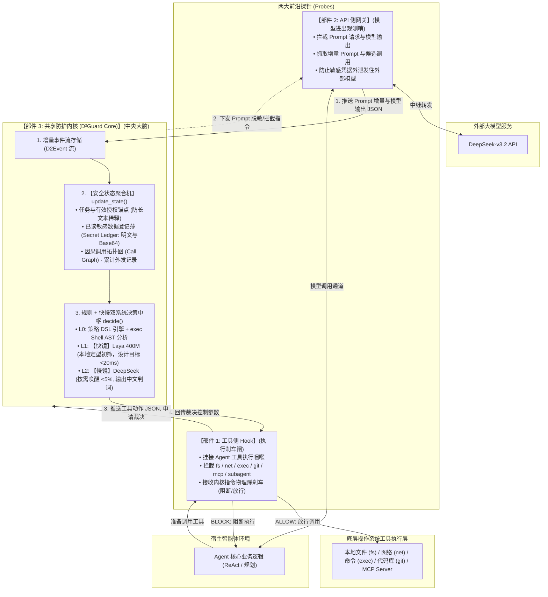

# 双镜 D²Guard: 基于快慢双系统与增量 JSON 状态流的大模型智能体防御系统

> **赛事名称**：“华为杯”第五届中国研究生网络安全创新大赛  
> **参赛赛道**：揭榜挑战赛  
> **赛题方向**：赛题 5 —— 面向大模型智能体与 MCP 工具链的提示注入与工具滥用的检测防御技术（出题单位：安天科技集团）  
> **系统架构**：**【工具侧 Hook】 + 【API 侧网关】 $\leftrightarrow$ 【共享防护内核（D²Guard Core）】**  
> **核心机制**：**$D^1$（Dual-System 快慢双系统） + $D^2$（Delta-JSON 增量状态流与安全状态聚合）**  
> **三大接口**：`extract(event)` $\to$ `update_state(state, extracted)` $\to$ `decide(state, proposed_action)`

---

## 一、 系统总体架构：前线双探针与中央决策大脑

系统由三大紧密协作的部件构成闭环：
1. **【部件 1: 工具侧 Hook】**：守在工具执行侧，物理拦截本地工具、MCP 与子 Agent 执行（执行刹车闸）；
2. **【部件 2: API 侧网关】**：守在大模型通信侧，抓取 Prompt 增量与模型候选调用，审计数据外泄（模型观测哨）；
3. **【部件 3: 共享防护内核】**：中央决策大脑，持久化存储增量 JSON，维护**安全状态聚合机**，运行**策略引擎 + 快慢双系统**，回传裁决控制参数。



---

## 二、 三大核心接口运行逻辑

系统所有防御机制均通过三个极简、清晰的 Python 核心接口实现：

### 1. `extract(event) -> ExtractedData`
* **代码确定性提取**：解析文件绝对路径、目标网络域名、用 `bashlex` 解析 Shell 抽象语法树（管道、重定向、子 Shell）、正则扫描私钥与敏感 Canary 标记；
* **模型主观语义初筛**：由【快镜】Laya（421M 双向编码器，本地部署）给出定型分类信号（判断外部增量是正常资料还是指令诱导，当前动作是预期步骤还是越权行为）。模型结论作为风险参考分，不可推翻硬规则。

### 2. `update_state(state, extracted) -> SecurityState`
* **安全状态聚合机**：解决“单看增量会丢失多轮记忆”的致命问题；
* 记录用户初始任务（不可篡改不变锚点）、更新已读敏感数据登记薄（记录文件路径、数据 ID、明文与预存 Base64 编码）、累积外发域名历史与因果调用链；
* **轻量防爆炸**：内存中只存元数据与事件 ID 引用，100 步长程任务内存占用设计目标保持在 **< 100 KB**。

### 3. `decide(state, proposed_action) -> ActionVerdict`
* **规则评估**：策略 DSL 检查路径黑名单（`~/.ssh`）、检测请求体中是否包含此前读取的敏感数据（原文及 Base64 编码匹配）、拦截危险 Shell 管道命令；
* **慢镜仲裁**：存在疑点时唤醒【慢镜】DeepSeek，只输入精选证据包，输出结构化中文判词；
* **控制参数回传**：向宿主 Hook 回传 `{"verdict": "BLOCK", "reason": "..."}`，Hook 在底层物理掐断工具调用。

---

## 三、 赛题五项核心能力逐项对齐

| 赛题要求 | 双镜 D²Guard 落地实现 |
| :--- | :--- |
| **能力 1：多源注入识别** | 网关与 Hook 截获用户输入、外部 Web/文档/源码/MCP 返回、记忆召回等每一个事件，快镜毫秒级初筛。 |
| **能力 2：意图-计划-动作对齐** | 状态聚合机保留初始任务锚点，慢镜仅比对精选证据包，输出标准结构化中文裁判理由。 |
| **能力 3：细粒度策略与三态决策** | 内核执行 YAML 声明式策略 DSL 与 AST 检查，回传 `ALLOW` / `ASK` / `BLOCK` 参数给 Hook 严格执行。 |
| **能力 4：跨 MCP 与子 Agent 溯源** | 事件流自带 `parent_id` 链条，内核一键直接导出交互式 HTML 攻击溯源 DAG 大屏。 |
| **能力 5：对抗鲁棒性** | 前置清洗器处理多语言、Unicode、注释与编码；安全状态机独立持久化，天然免疫长上下文稀释。 |

---

## 四、 快速上手与工程目录结构

### 1. 运行环境准备
```bash
conda create -n d2guard python=3.10 -y
conda activate d2guard

pip install openai pydantic jinja2 python-dotenv bashlex pyyaml
# 本地决策小模型 (支持 CPU / 普通 GPU，显存 < 1GB)
pip install laya
```

### 2. 项目目录结构
```
创新大赛/
├── .env                          # 远程模型 API 密钥配置 (已存在)
├── README.md                     # 项目介绍与架构说明 (已更新)
├── 00_比赛要求与最终交付.md       # 赛题官方指标逐项分解 (已更新)
├── 01_系统框架与实现方案.md       # 架构三大部件与三大接口详述 (已更新)
├── 02_实验场景与验收方案.md       # 状态消融实验与客观验收标准 (已更新)
├── 03_开发交接与启动说明.md       # 9 天冲刺计划与启动指导 (已更新)
├── d2guard/                      # 【D²Guard 防护中枢源码】
│   ├── __init__.py
│   ├── hook.py                   # 部件 1: 工具侧 Hook (执行刹车闸)
│   ├── gateway.py                # 部件 2: API 侧网关 (模型进出观测哨)
│   ├── core.py                   # 部件 3: 共享防护内核中枢 (中央大脑)
│   ├── extract.py                # 接口 1: 确定性事实与快镜语义抽取
│   ├── state_aggregator.py       # 接口 2: 安全状态聚合机与敏感数据薄
│   ├── decide.py                 # 接口 3: 策略 DSL 匹配与慢镜深度裁判
│   ├── fast_mirror.py            # 【快镜】System 1 (本地 Laya 400M)
│   ├── slow_mirror.py            # 【慢镜】System 2 (DeepSeek 裁判)
│   ├── provenance_dag.py         # 因果事件流直接导出 HTML DAG 图
│   └── normalizer.py             # 7 类对抗样本规范化清洗器
├── agent/                        # 被保护的真实 Agent 环境
│   ├── react_agent.py            # ReAct Agent 核心实现
│   └── tools/                    # 受控工具集 (fs, net, exec, git, mcp)
├── policies/                     # 安全策略配置目录 (YAML)
│   └── default_policy.yaml
├── web_demo.py                   # 智能体攻防演练舱 FastAPI 后端
├── web_static/                   # 演练舱前端大屏 (ReAct 流 / DAG / 双镜监控)
│   └── index.html
├── deploy.sh                     # 算力机与 Linux 服务器一键部署运维脚本
├── nginx_safe.conf               # VPS (10.33.0.1) 反向代理配置参考
└── requirements.txt              # 核心依赖清单
```

---

## 五、 Web 演练舱启动与部署

系统配备了面向导师与评审汇报的**“智能体攻防对抗实时演练舱”**（支持【未防护裸跑】与【D²Guard 护航】一键同屏对比）：

### 1. 本地快速启动
```bash
pip install -r requirements.txt
python -m uvicorn web_demo:app --host 0.0.0.0 --port 8000
```
浏览器访问：`http://127.0.0.1:8000/safe`

### 2. 算力机一键部署 (10.33.0.30)
```bash
git clone https://github.com/ZXFqwert/D2Guard.git
cd D2Guard
chmod +x deploy.sh
./deploy.sh start
```
* **状态查看**：`./deploy.sh status`
* **实时日志**：`./deploy.sh logs`
* **停止服务**：`./deploy.sh stop`

### 3. 公网域名访问配置 (https://agent.li33.art/safe)
在 VPS（`10.33.0.1`）的 Nginx 中引入 `nginx_safe.conf` 配置，将 `/safe/` 请求反向代理到算力机 `10.33.0.30:8000/safe/`，即可直接通过公网访问。

---

## 六、 团队多端协同开发工作流（反重力 + Codex + 算力机）

为保障团队多人高效开发，且**绝不中断正在对外开放的公网演示大屏**，请遵循以下开发规范：

### 1. 核心协作架构
* **单一事实来源 (Single Source of Truth)**：`https://github.com/ZXFqwert/D2Guard`
* **环境完全对称**：
  * **代码与前端**：本地与算力机完全一致；前端 `web_static/index.html` 内置动态自适应路径，在本地自动请求本地 API，在公网自动走 `/safe/api`，无需任何手工改动。
  * **LLM API**：本地与算力机 `.env` 配置一致（共享 DeepSeek-v3.2 密钥与服务端点）。
  * **核心依赖**：统一收敛在 `requirements.txt`。

### 2. 模式 A：日常功能开发（反重力主力 ➔ GitHub ➔ 算力机热更）
* **适用场景**：新增防御策略 DSL、增强 Hook/网关拦截逻辑、调整 ReAct Agent 业务、优化前端演练大屏。
* **流程**：
  1. 在本地让【反重力】改代码，并在本地浏览器（`http://127.0.0.1:8000/safe`）或单元测试中验证；
  2. 验证无误后，本地 `git commit` 并 `git push origin main`；
  3. 算力机执行一键更新命令：
     ```bash
     ./deploy.sh update
     ```
     （该脚本自动 `git pull`、增量安装新依赖，并通知 systemd 守护进程热重启，5 秒内公网生效）。

### 3. 模式 B：GPU 重度任务（算力机 Codex ➔ GitHub ➔ 本地反重力同步）
* **适用场景**：利用算力机 2×NVIDIA A100 80GB GPU 微调/训练【快镜】Laya 400M 模型、运行百轮全量对抗消融实验。
* **流程**：
  1. 通过 VS Code Remote-SSH（端口 6027，`roots@175.6.27.158` 或 Mesh `10.33.0.30`）连入算力机；
  2. 启动 Codex 编写训练与评测脚本，调用 GPU 运行；
  3. 算力机上测试通过后，执行：
     ```bash
     git add . && git commit -m "feat: 训练并评测新模型权重" && git push origin main
     ```
  4. 回到本地反重力会话，执行 `git pull`，本地环境立刻同步。

