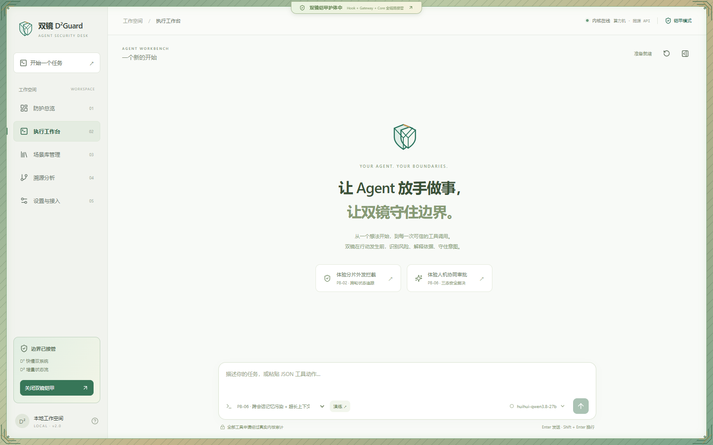

# 双镜 D²Guard · 桌面 App 与 Web 工作台

当前主版本直接位于仓库根目录：**`D2guard_core/` 是审计内核，`D2guard_desk/` 是新版桌面界面。** 旧版 Arena 及历史赛题材料已归档至 [legacy/](legacy/)。

[下载 Windows App](https://github.com/ZXFqwert/D2Guard/releases/tag/unified-v1.0.0) · [在线体验新版](https://agent.li33.art/safe/desk/) · [部署与回滚](deployment/RELEASE.md) · [旧版 Arena](https://agent.li33.art/safe/)



## 直接使用

**Windows：** 下载 Release 中的 `D2Guard-1.0.0-Windows-x64.zip`，完整解压，双击 `D2Guard.exe`。发行包自带 Python 内核，无需安装 Python 或 Node。重复打开会聚焦已有窗口，关闭窗口会回收内核。代码尚未进行 Windows 签名。

**网页：** 打开 <https://agent.li33.art/safe/desk/>。网页通过同源 API 访问算力机；旧版 `/safe/` 继续独立提供服务。

仓库为私有仓库，下载需要有访问权限的 GitHub 账号。发行包和源码不携带 API Key、个人模型配置或审计数据库。

## 五个独立页面

- **防护总览：** 真实会话 KPI、策略分布、风险与快慢镜耗时曲线、近期拦截。
- **执行工作台：** 任务与工具执行流、PB-01 至 PB-06 快捷演练、ASK 批准/拒绝、可折叠安全详情。
- **场景库管理：** 搜索筛选、增删改查、JSON 导入导出、一键真实演练。
- **溯源分析：** MCP / 子 Agent DAG、全链路时序、字符与 Token 证据、Markdown / JSONL 报告。
- **设置与接入：** 模型配置、主模型与慢镜选择、运行健康及 YAML 策略。

普通模式使用温润浅色桌面界面；启用双镜铠甲后，窗口外侧展开几何护甲边框。

## 当前目录

```text
D2guard_core/        审计内核、五条 HTTP 契约、模型配置与观测接口
D2guard_desk/        React 工作台、Electron 桌面入口
  electron/standalone.cjs  发行包入口，自动启动随附内核
  src/                    五个页面与原始真实 API 通信逻辑
deployment/         单端口运行器、Linux 部署、旧版兼容入口
scripts/            Windows 打包与 Playwright 验收脚本
tests/              当前版本集成测试
legacy/             旧版 Arena、旧文档和比赛材料
start_all.py        原开发启动守护器
```

## 从源码运行与打包

开发需要 Python 3.11+、Node.js 22+，在仓库根目录运行：

```powershell
python start_all.py
# 浏览器开发模式
python start_all.py --web
# 自带内核的 Windows 发行包
pwsh -File scripts/build-desktop.ps1
```

也可以双击根目录 `启动D2Guard-Desk.bat`。开发启动器使用 8765 / 5173；发行版 App 只用 8765 提供页面和 API。端口冲突会明确报错，不会终止其他进程。详细说明见 [deployment/README.md](deployment/README.md)。

## 算力机一键部署

首次部署：

```bash
git clone https://github.com/ZXFqwert/D2Guard.git
cd D2Guard
bash deployment/deploy.sh
```

当前算力机更新：

```bash
cd /home/roots/d2guard-current
bash deployment/deploy.sh --pull
```

新版服务使用独立环境，数据保存在 `~/.local/share/d2guard-unified/`。部署不改写旧版运行目录；公网兼容入口同时保留 `/safe/` 与 `/safe/desk/`。服务位置、健康检查和回滚命令见 [发布记录](deployment/RELEASE.md)。

## 模型与真实审计

桌面设置页支持 Base URL、API Key、主模型和慢镜模型，兼容 Chat Completions / Responses。模型密钥保存在本机内核数据库，不回传浏览器，不进入导出报告；未配置时降级到本地任务登记与结构化复核。公共体验站模型由管理员维护。

全部裁决、ASK 审批和铠甲开关仍走真实内核的五条原 HTTP 契约。主模型建议的动作仍需经过 Hook 裁决。演练只展示真实审计和授权结果，不执行恶意外发、推送或系统文件写入；合规成功率表示申请获授权的比例。

本次仓库整理只移动文件位置：`d2guardClient.ts`、`AgentHarness.ts`、`D2GuardHook.ts`、启动守护器和内核代码的内容保持不变。

## 验证

Windows 和 Linux 各 192 项 pytest 通过；桌面与 Web 构建成功。实际打包 App 与公网版已通过六大剧本的普通/铠甲模式、ASK 批准/拒绝、自由输入和真实模型链路验收。

```powershell
.\D2guard_core\.venv\Scripts\python.exe -m pytest -q
npm.cmd --prefix D2guard_desk run build
npm.cmd --prefix D2guard_desk run build:web
```

Linux 在 `.venv-server` 激活后运行 `python -m pytest -q`。默认测试范围只包含当前版本，旧测试在 `legacy/tests/` 中保留。完整验收与发行包 SHA256 见 [deployment/RELEASE.md](deployment/RELEASE.md)。
