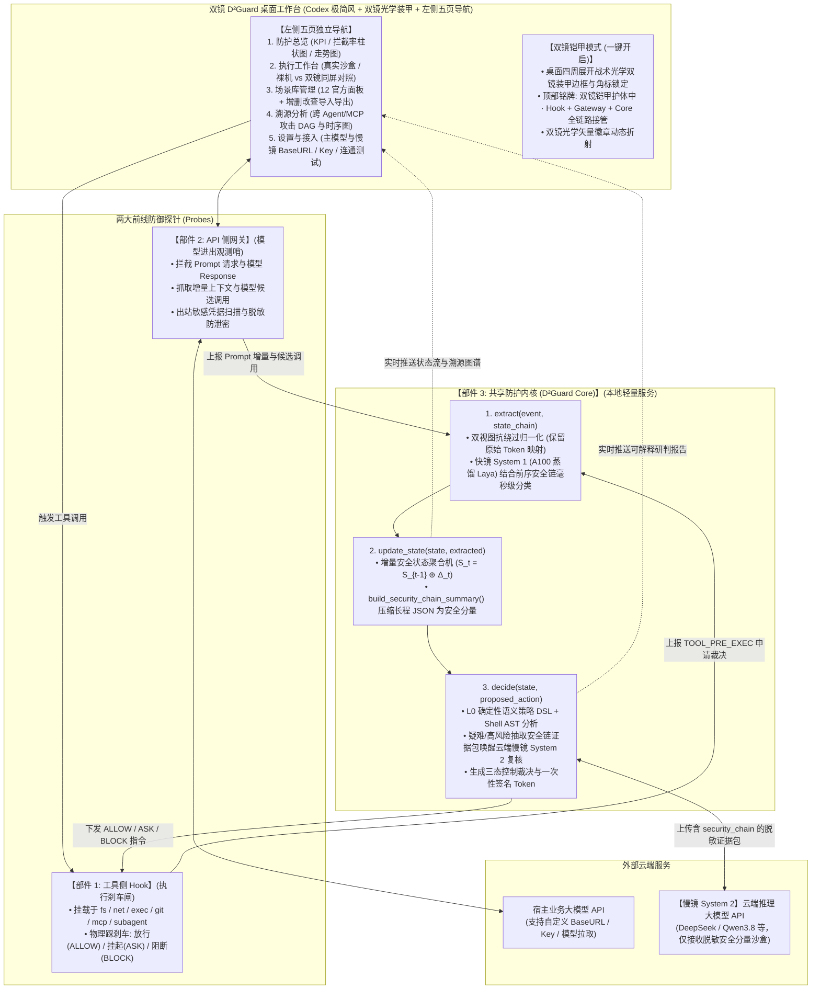

# 双镜 D²Guard：基于快慢双系统与增量安全状态流的大模型智能体闭环防御系统

## —— 整体设计文档

### 摘要

本项目面向大模型智能体（LLM Agent）与 MCP（Model Context Protocol）工具链中的提示注入、工具滥用及跨 Agent 攻击传播，设计 **“工具侧 Hook ＋ API 侧网关 ＋ 共享防护内核”** 协同架构，构建覆盖“检测、研判、阻断与溯源”的运行时安全闭环。
系统以 **$D^1$：快慢双系统（Dual-System）** 与 **$D^2$：增量安全状态流（Delta-State Stream）** 为核心机制。针对长程任务（50+ 轮交互）产生的超长 JSON 上下文与约束稀释难题，系统通过 `build_security_chain_summary()` 将前序安全状态链 $S_{t-1}$ 实时压缩为定长、零敏感明文泄露的**结构化安全分量（Security Components）**。**快镜（System 1）** 通过在双 A100 80GB 算力集群上针对“前序安全状态链 + 当前增量 $\Delta_t$”微调并轻量化蒸馏的 Laya 决策模型（`laya_d2_distilled.json`），在普通办公 PC（纯 CPU）上以 `P95 = 0.25ms` 完成意图—计划—动作的快速分类；**慢镜（System 2）** 通过云端按需调用的推理大模型（支持 DeepSeek / Qwen3.8 / OpenAI 兼容接口）针对高风险或疑难冲突，基于从安全状态链抽出的精选脱敏证据包（`EvidencePack`）开展语义对齐研判。两者与确定性语义策略引擎（YAML DSL）协同，输出 `ALLOW / ASK / BLOCK` 三态裁决，由工具侧 Hook 在实际副作用发生前实施物理控制。
工作台客户端（`D2guard_desk`）融合 **Codex 桌面极简美学**、**双镜光学战术装甲边框** 与 **五页独立导航架构（防护总览、执行工作台、场景库管理、溯源分析、设置与接入）**，内置 12 组全链路攻防演练场景与真实受控沙盒运行时（`agent_runtime.py`），并输出可视化攻击溯源有向无环图（DAG）、时序链路与可解释中文研判报告。

---

### 一、 系统总体架构与闭环通信拓扑

#### 1.1 架构设计哲学：开发期 A100 重算力训模与蒸馏，运行期普通 PC 极速护航

为兼顾检测精度与企业级/个人桌面级落地可行性，双镜 D²Guard 采用 **“离线 A100 算力集群微调蒸馏 + 在线普通 PC 零显卡极速部署”** 路线：

* **研发期（双 NVIDIA A100 80GB PCIe 离线训练与蒸馏）**：利用算力集群构建覆盖 12 大攻防场景、多轮上下文稀释、分片外发与混淆绕过的 1,280 条 `(SecurityChain S_{t-1} + CurrentDelta Δ_t)` 联合样本集，基于 `convaiinnovations/laya-multilingual`（768 维教师编码器）开展双头监督微调与轻量化特征网络蒸馏，导出纯 CPU 可直接加载的权重文件 `D2guard_core/weights/laya_d2_distilled.json`（验证集动作对齐准确率 `100.0%`，综合联合准确率 `97.40%`）及完整支持 `laya` / `laya-int8` / `onnx` 推理后端。
* **运行期（普通 PC 轻量化部署）**：客户端采用 Electron + FastAPI 本地服务架构（亦可单端口部署为 Web 体验站），可直接运行于无独立显卡的普通办公电脑。本地运行确定性策略引擎与蒸馏后的 Laya 快镜模型（1,000 次样本实测延迟 `P50 = 0.115ms`、`P95 = 0.253ms`、`P99 = 0.349ms`，远低于 `< 15ms` 预算）；仅当快镜或硬规则识别出高风险/疑难语义冲突时，才通过加密 API 将脱敏精选安全分量证据包发送至云端慢镜大模型进行深度复核。

#### 1.2 三大核心部件与五页桌面工作台

系统由两大前线探针（工具侧 Hook、API 侧网关）、中央决策大脑（共享防护内核 `D2guard_core`）以及五页独立导航桌面工作台（`D2guard_desk`）共同构成闭环：



#### 1.3 跨探针事件去重与生命周期对齐

同一工具调用先后经过 API 侧网关（模型生成候选调用）与工具侧 Hook（实际准备执行）。内核通过全局唯一 `call_id` 统一对齐三阶段生命周期：

1. `MODEL_PROPOSED`（网关上报）：仅记录模型候选意图与关联上下文，不计入实际外发或已读账本；
2. `TOOL_PRE_EXEC`（Hook 上报）：工具真正执行前挂起，触发内核 `decide()` 进行裁决；
3. `TOOL_POST_EXEC`（Hook 上报）：工具执行完毕，提取返回内容中的新污点或登记新读取的敏感凭据。

---

### 二、 核心机制：$D^2$ 增量安全状态链压缩与三大标准接口流水线

共享防护内核严格围绕 `extract → update_state → decide` 三大标准接口运转，并通过 `build_security_chain_summary()` 将多轮长上下文压缩为高信噪比的安全分量：

```
[多源增量事件 D2Event + 前序安全链 S_{t-1}] ──> extract(event, mirror, state_chain)
    ──> update_state(state, extracted) ──> decide(state, action) ──> [ALLOW / ASK / BLOCK]
```

#### 2.1 长程上下文压缩机制：`build_security_chain_summary(state)`（抗 50+ 轮上下文稀释）

在长程智能体任务中，多轮工具返回的原始 JSON 往往长达数万 Token，直接拼接历史上下文不仅拖慢推理，还会导致早期注入污点或只读锚点被稀释。`state_machine.py` 中的 `build_security_chain_summary` 将任意长度的历史状态 $S_{t-1}$ 压缩为固定 12 个键的**结构化安全分量**：

* `anchor_type` / `intent_locked`：首帧锁定的可信任务类型（如 `code_review_readonly`）及锁定状态；
* `taint_active` / `taint_nature` / `taint_alignment` / `taint_token_span`：前序链路中是否已摄入不可信外部指令污点及其性质、偏离度与原始 Token 跨度；
* `secret_ledger_count` / `max_coverage_ratio`：当前会话已接触的敏感凭据总数及对外部域名的最高滑动分片外发覆盖率；
* `dag_node_count` / `prior_call_chain`：因果图规模与最近 6 步 `agent_id:tool_name` 紧凑调用序列；
* `proposed_tool` / `has_plan`：当前待审工具动作与计划完备性。

> **核心优势**：该安全分量体积恒定（`< 400 Bytes`），且**天然不含任何明文密钥、原始文本或工具参数原文**，既能直接作为快镜 Laya 的结构化特征输入，又能安全注入慢镜 System 2 的 `<audit_evidence_sandbox>` 证据沙盒。

#### 2.2 接口一：`extract(event, mirror, state_chain) -> ExtractedData`（多源清洗、Token 染色与快镜初筛）

该阶段负责将原始增量事件与前序安全状态链结合，转化为结构化安全特征，同时攻克 **能力 1（多源注入识别）** 与 **能力 5（对抗鲁棒性）**：

1. **多源输入统一纳管与来源染色**：
   对用户输入（`USER`）、外部网页（`WEB`）、本地文件（`LOCAL_FILE`）、MCP 工具描述与返回字段（`MCP_DESC/MCP_RET`）、跨会话记忆库（`MEMORY`）及子 Agent 输出（`SUBAGENT`）统一分配节点标识，并记录精确字符区间 `char_span` 与分词器 `token_span`。
2. **非破坏性“双视图”抗绕过预处理（`normalize`）**：
   * **原始视图（Raw View）**：保持原文不变，维护精确的原始字符与 Token 偏移映射 `OffsetMapping`；
   * **归一化检测视图（Canonical View）**：依次执行 `Unicode NFKC` 规范化、西里尔/希腊同形字还原、零宽控制字符剥离、`/* */` 注释剥离、`$IFS` 空格还原、引号拼接合并以及双层有界 Base64 载荷自动解码。
3. **【快镜 System 1】本地微调蒸馏 Laya 结合安全状态链极速分类**：
   将 `(当前归一化增量文本 + 执行计划 + 前序安全分量 state_chain)` 共同输入本地 FastMirror（`laya-distilled` / `laya`），在 `< 1ms`（CPU 实测 `P95 = 0.25ms`）内输出：
   * **内容性质（`content_nature`）**：`informational` / `directive` / `example` / `uncertain`；
   * **动作对齐倾向（`action_alignment`）**：`expected` / `ancillary` / `deviant` / `insufficient`。
   * 即使第 15 轮攻击动作表面参数看似普通，只要前序安全分量 `taint_active=True` 且当前动作冲击高危工具或违背只读锚点，快镜也能跨越长程稀释精准检出 `deviant`。

#### 2.3 接口二：`update_state(state, extracted) -> SecurityState`（增量安全状态聚合机）

该阶段维护独立于大模型上下文的宿主安全账本（基于 SQLite 事务存储与内存热状态），状态跃迁满足 $S_t = S_{t-1} \oplus \Delta_t$：

1. **防稀释任务授权锚点（`anchor_intent`）**：会话首帧仅允许真实 `USER_INPUT` 建立不可篡改的任务锚点（如自动识别 `code_review_readonly`），后续任何外部文件或 MCP 返回均无法覆盖。
2. **敏感数据滑动分片登记簿（`secret_ledger`）**：当 `TOOL_POST_EXEC` 阶段读取敏感路径或包含密钥特征的内容时，自动登记明文、Base64 变体及 **8 字节滑动窗口子片段（`sub_chunks` / `encoded_chunks`）**。
3. **跨轮分片外发累积追踪（`accumulated_outbound`）**：按目标域名累积命中敏感分片的字节位置并集覆盖率（`coverage_ratio`）。一旦单域名累计覆盖率达到阈值（$\ge 50\%$），立即由策略引擎判定为分片窃密并阻断。

#### 2.4 接口三：`decide(state, proposed_action) -> ActionVerdict`（策略引擎、慢镜复核与三态控制）

1. **L0 细粒度语义策略 DSL 引擎（覆盖赛题能力 3 全部五项强制规则）**：
   * `POL-FS-WRITE-SENSITIVE`：跨平台路径规范化、解码与符号链接消解，禁止向 `.ssh`、`.aws`、`cron`、自启动目录等敏感路径写入（同时阻止通过 `exec` 调用 `cp/mv/touch/out-file` 等绕过）；
   * `POL-NET-SECRET-EXFIL`：禁止向非白名单域名外发已登记敏感凭据明文、编码变体或累计覆盖率 $\ge 50\%$ 的滑动分片；
   * `POL-GIT-REVIEW-NO-PUSH`：当首帧锚点为 `code_review_readonly` 时，强制阻断 `git.push` 与 `git.commit`；
   * `POL-EXEC-RESTRICT`：基于 `bashlex` AST 语法树拦截管道执行（`curl | sh`）、命令替换、危险链式执行及敏感环境变量读取；`SafeExecutor` 强制 `shell=False`、锁定 `cwd` 并物理净化敏感环境变量；
   * `POL-SUBAGENT-SECRET-LEAK`：禁止通过 `spawn_subagent` 向子 Agent 传递任何已登记敏感凭据或分片。
2. **【慢镜 System 2】基于压缩安全链证据包的云端沙盒研判**：
   当触发拦截或可疑污点时，`enrich_report()` 将包含 `security_chain` 的精选脱敏字段封装于 `<audit_evidence_sandbox>` 标签内发送至云端慢镜模型（支持 `/chat/completions` 与 `/responses` 双协议），基于“意图锚点—前序状态链—当前动作”生成中文合规审计复核意见；若离线或超时，无缝回退至本地结构化中文判词，且绝不影响本地裁决结果。
3. **三态控制与单次签名令牌（`ApprovalManager`）**：
   `ASK` 状态签发绑定 `(session_id, call_id, args_hash, nonce, ttl)` 的 HMAC-SHA256 单次令牌；二次审批时重新核验最新硬策略，确保硬阻断规则不可被覆盖。

---

### 三、 桌面工作台（`D2guard_desk`）视觉与五页功能架构

1. **视觉双态设计（Codex 极简风 + 双镜光学装甲）**：
   * **普通模式（裸机态）**：复刻 OpenAI Codex 桌面版的清爽极简布局与双镜几何光学矢量徽章；
   * **双镜防护模式（铠甲态）**：开启后桌面四周展开**战术光学双镜装甲边框（`ArmorFrame`）**、四角瞄准锁定框与顶部状态铭牌（`双镜铠甲护体中 · Hook + Gateway + Core 全链路接管 · D¹ Laya · D² StateFlow`），直观呈现“插件 + 网关 + 内核”全链路接管宿主 Agent。
2. **左侧五页独立导航**：
   * **防护总览**：实时展示拦截率、放行率、快慢镜延迟、五项策略命中分布柱状图与风险走势图；
   * **执行工作台**：支持 12 个内置攻防场景演练、自由任务真实沙盒执行（`agent_runtime.py`）、`裸机 vs 双镜` 一键同屏对照回放及 `ASK` 人工确认弹窗；
   * **场景库管理**：管理 12 个标准攻防场景与自定义场景，支持详情抽屉检视、新增、编辑、删除与 JSON 导入导出；
   * **溯源分析**：交互式展示跨主 Agent、子 Agent 与 MCP 节点的攻击传播有向无环图（DAG）、Token 级染色高亮、时序瀑布图与影响范围报告导出；
   * **设置与接入**：支持一键配置主 Agent 模型与慢镜 System 2 模型的 `Base URL`、`API Key`、协议类型（`chat_completions` / `responses`），支持远程拉取可用模型列表与独立连通性测试。
